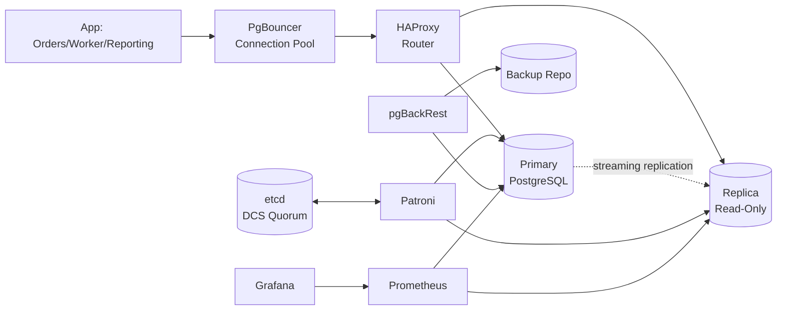

# Book Package — Full Book

**Working title:** PostgreSQL ระดับโปรดักชัน: คู่มือสร้างระบบฐานข้อมูลที่พร้อมใช้งานจริง
**Slug:** `postgresql-production`
**Genre:** Nonfiction / Technical (คู่มือปฏิบัติการ)
**Market:** หนังสือไทย (developer / DevOps / DBA)
**Created:** 2026-10-09
**Based on:** หลักสูตรอบรม PostgreSQL 5 วัน — "NovaMart Order Platform"

---

## สารบัญแพ็กเกจ (Package Contents)

1. [Book Concept & Positioning](#1-book-concept--positioning)
2. [Chapter Outline](#2-chapter-outline)
3. [Chapter Draft — บทที่ 1](#3-chapter-draft--บทที่-1)
4. [Voice & Style Guide](#4-voice--style-guide)
5. [Manuscript Plan](#5-manuscript-plan)
6. [Self-Publish Roadmap](#6-self-publish-roadmap)

---

# 1. Book Concept & Positioning

## 1.1 Book Concept (สูตร)

> **หนังสือเล่มนี้ช่วย [วิศวกรซอฟต์แวร์/DBA ที่เริ่มดูแล PostgreSQL ในงานจริง] ที่ [ติดตั้งได้แต่ไม่รู้จะทำให้ "พร้อมโปรดักชัน" อย่างไร — กลัวข้อมูลหาย กลัวระบบล่มตอนตีสาม] ให้ [สามารถออกแบบ ติดตั้ง ป้องกัน และกู้คืนระบบ PostgreSQL ที่พร้อมใช้งานจริงได้อย่างมั่นใจ] ด้วย [เส้นทางการเรียนรู้ 5 วันจากหลักสูตร NovaMart Order Platform ที่พาจากสถาปัตยกรรมภายในไปสู่ HA, Backup, Observability และ Game Day บน Ubuntu 24.04 + PostgreSQL 17→18]**

## 1.2 Big Idea

**"PostgreSQL ไม่ได้จบที่ `CREATE TABLE`"** — ระบบฐานข้อมูลที่ "พร้อมโปรดักชัน" ประกอบด้วย 5 เสาหลักที่ต้องทำงานร่วมกัน: (1) เข้าใจกลไกภายใน, (2) วางแผนสำรอง/กู้คืนได้จริง, (3) เฝ้าดูและวัดผลได้, (4) รับมือความล้มเหลว (HA/Failover), และ (5) ฝึกซ้อมจนชำนาญ (Game Day) — หนังสือเล่มนี้พาผู้อ่านสร้างทั้ง 5 เสาหลักบนโปรเจกต์สมมติที่โต้จริง (NovaMart Order Platform) แทนการท่องคำสั่งแบบแยกส่วน

## 1.3 Promise (สัญญากับผู้อ่าน)

- อ่านจบแล้ว **ติดตั้งและตั้งค่า PostgreSQL ให้พร้อมโปรดักชันบน Ubuntu ได้เอง** (ทำตาม lab ได้จริง)
- **กู้คืนฐานข้อมูลจาก PITR ได้** — ไม่ใช่แค่ทฤษฎี แต่ทำ Backup/Recovery ด้วย pgBackRest จริง
- **ตั้งค่า HA ด้วย Patroni + etcd + HAProxy + PgBouncer** และทดสอบ failover ได้
- **มี Dashboard สังเกตการณ์ (Prometheus + Grafana)** และ Alerting ที่ใช้ได้
- **รู้ขั้นตอน RCA 6 ขั้น** เพื่อแก้ปัญหาจริงอย่างเป็นระบบ ไม่ใช่เดาสุ่ม
- มี **Checklist / Test Manual / Maintenance Manual** ที่หยิบไปใช้ในทีมได้ทันที

## 1.4 Target Reader (กลุ่มเป้าหมาย)

| กลุ่ม | ระดับ | สิ่งที่ต้องการ |
|------|-------|----------------|
| Backend / Full-stack Developer | กลาง–สูง | ดูแล DB ที่ตัวเอง deploy ไม่อยากพึ่ง DBA ตลอด |
| DevOps / SRE | กลาง | รับผิดชอบ reliability ของ data layer และ on-call |
| Junior DBA | เริ่ม–กลาง | อยากมีเส้นทางเรียนรู้จาก 0 → production-ready |
| Tech Lead | สูง | ต้องการมาตรฐาน/template ให้ทีม + คู่มือ review & maintenance |

## 1.5 ความรู้พื้นฐานที่ผู้อ่านควรมี (Prerequisites)

- ใช้ Linux command line ได้ (Ubuntu/Debian กำลังดี)
- เข้าใจ SQL พื้นฐาน (`SELECT/INSERT/UPDATE/DELETE`, index, join)
- รู้จัก container/Docker เบื้องต้น
- ไม่จำเป็นต้องมีประสบการณ์ DBA — หนังสือจะปูพื้นสถาปัตยกรรมให้

## 1.6 Proof (หลักฐานความน่าเชื่อถือ)

- อิง **หลักสูตรอบรม 5 วันที่มี lab ครบทุกหัวข้อ** (ไม่ใช่ตำราทฤษฎี)
- ใช้ **stack จริงที่ใช้ในองค์กร**: Ubuntu 24.04, PostgreSQL 17→18, Patroni, etcd, HAProxy, PgBouncer, pgBackRest, Prometheus, Grafana
- มี **โค้ด/สคริปต์ที่รันได้จริง** ทุกบท (ตามโครงสร้างสรุปของแต่ละบท)
- มี **Game Day scenario** จำลองเหตุการณ์จริง (disk full, corruption, failover, capacity)
- เผย **ข้อควรระวัง / ข้อห้าม / กับดัก** จากประสบการณ์ปฏิบัติการ

## 1.7 Competition (คู่แข่ง/ทางเลือกอื่น)

| ทางเลือก | จุดอ่อนที่หนังสือเล่มนี้แก้ |
|----------|---------------------------|
| เอกสาร PostgreSQL ทางการ | ครอบคลุมแต่ไม่บอกว่า "พร้อมโปรดักชัน" ต้องทำอะไรก่อน-หลัง |
| คอร์สออนไลน์ต่างประเทศ | แพง โครงสร้างไม่ตรงกับบริบททีมไทย ไม่มี maintenance manual |
| บทความ/blog กระจัดกระจาย | ไม่เชื่อมโยงเป็นระบบ ไม่มี HA + Backup + Observability ครบในที่เดียว |
| หนังสือ DBA เล่มหนา | เน้น version เก่า/ทฤษฎี ไม่มี lab 5 วัน + checklist พร้อมใช้ |

## 1.8 Unique Selling Proposition (USP)

> **"หลักสูตร 5 วันในรูปเล่ม"** — จากศูนย์ถึง production-ready พร้อมโค้ดที่รันได้, diagram dataflow จริง, checklist test/maintenance/review/RCA ที่ทีมนำไปใช้ต่อได้ทันที

## 1.9 Positioning Statement

> สำหรับวิศวกรที่ต้องรับผิดชอบ PostgreSQL ในงานจริง — หนังสือเล่มนี้คือคู่มือเชิงปฏิบัติที่พาจากพื้นฐานไปสู่ระบบ HA ที่กู้คืนได้ เฝ้าดูได้ และพร้อมรับเหตุการณ์ฉุกเฉิน ต่างจากตำรา DBA ทั่วไปที่เน้นทฤษฎี เพราะเราสร้างทุกอย่างบนโปรเจกต์ NovaMart จริงตลอด 5 วัน

---

# 2. Chapter Outline

> **หมายเหตุ:** โครงสร้างสารบัญด้านล่างเป็นไปตามที่ผู้อ่านกำหนด (mandatory structure) ครบทุกหัวข้อ
> Word count target รวมประมาณ **45,000–60,000 คำ** (หนังสือเทคนิคไทย ~300–380 หน้า)

| # | บท | เนื้อหา | คำเป้าหมาย |
|---|-----|---------|-----------|
| — | บทนำ (Introduction) | ที่มา, ปัญหา, เป้าหมาย, วิธีอ่านหนังสือ, สถาปัตยกรรม NovaMart โดยรวม | 2,000 |
| — | บทนิยาม (Definitions) | glossary: WAL, PITR, Replica, Failover, Quorum, MVCC, pgBackRest, Patroni, DCS ฯลฯ | 1,500 |
| 1 | รู้จัก NovaMart Order Platform และเหตุผลที่ต้องทำ PostgreSQL ระดับโปรดักชัน | บริบทโจทย์, โครงสร้างการทำงาน, วัตถุประสงค์, กลุ่มเป้าหมาย, ความรู้พื้นฐาน, เนื้อหาโดยย่อ | 3,000 |
| 2 | สถาปัตยกรรม interiors ของ PostgreSQL (Day 1) | MVCC, WAL, buffer, process model, planner (Concept) | 4,000 |
| 3 | Linux Essentials & Installation (Day 2) | เตรียม Ubuntu, tuning, ติดตั้ง PG17→18 (คู่มือการใช้งาน) | 4,000 |
| 4 | โครงสร้างโฟลเดอร์ & หลักการทำงาน | folder-structure, directory layout, config layout (Concept) | 3,000 |
| 5 | Performance, Observability & Maintenance (Day 3) | EXPLAIN, pg_stat_statements, index, vacuum/autovacuum, Prometheus+Grafana | 5,000 |
| 6 | Backup, Recovery & Security (Day 4) | pgBackRest, PITR, pg_dump, roles/TLS/RBAC, pg_hba | 5,000 |
| 7 | Replication, HA & Alerting (Day 4–5) | streaming/logical repl, Patroni+etcd+HAProxy+PgBouncer, failover, alerting | 5,000 |
| 8 | Upgrade, Troubleshooting, Kubernetes & Game Day (Day 5) | pg_upgrade, logical replication migration, K8s (StatefulSet/Operator), Game Day | 5,000 |
| 9 | Workflow และ Dataflow (ภาพรวม + diagram) | flowchart ทุก flow: request→pooler→primary/replica, backup flow, failover flow | 4,000 |
| 10 | คู่มือการทดสอบ + Check List Test | test manual: unit/integration/failover/restore drill + checklist | 3,500 |
| 11 | คู่มือการใช้งาน (Operation Manual) | daily ops, runbook, config reference | 3,000 |
| 12 | คู่มือการบำรุงรักษา (Maintenance Manual) | vacuum, reindex, bloat, patching, upgrade, capacity | 3,000 |
| 13 | คู่มือการขยาย/แก้ไข + Git Flow | scale vertical/horizontal, migration workflow, branch model | 3,000 |
| 14 | Code Review / PR + Checklist | มาตรฐาน review สคริปต์/change ของ DB, PR checklist | 2,500 |
| 15 | Root Cause Solution (RCA Manual) | ขั้นตอน RCA 6 ขั้น + ตัวอย่างจริง (case: replica lag, disk full) | 3,500 |
| 16 | สรุปภาพรวม | ประโยชน์/ข้อควรระวัง/ข้อดี/ข้อเสีย/ข้อห้าม/ตัวอย่างโค้ดรวม | 3,000 |

### 2.1 โครงสร้างบังคับในแต่ละบท (ทุกบทใช้ pattern นี้)

```
1. วัตถุประสงค์ของบท
2. ประโยชน์ที่ผู้อ่านจะได้
3. หลักการทำงาน (Concept)
4. โครงสร้างโฟลเดอร์ / ไฟล์ที่เกี่ยวข้อง
5. Workflow & Dataflow (diagram + อธิบาย)
6. ตัวอย่างโค้ดที่รันได้จริง
7. คู่มือการทดสอบ + Check List Test
8. สรุป: ประโยชน์ / ข้อควรระวัง / ข้อดี / ข้อเสีย / ข้อห้าม
```

### 2.2 โครงสร้างการทำงานของโปรเจกต์ (Project Concept)

```
┌─────────────────────────────────────────────────────────────┐
│  NovaMart Order Platform — Data Layer (Production Ready)     │
├─────────────────────────────────────────────────────────────┤
│  App (API/Worker)  ──►  PgBouncer  ──►  HAProxy  ──► Primary │
│                                            │                  │
│                                            └──► Replica (RO) │
│                                                               │
│  Cluster Control: Patroni + etcd (DCS)                        │
│  Backup: pgBackRest  │  Observe: Prometheus + Grafana        │
│  Runtime: Ubuntu 24.04  │  Engine: PostgreSQL 17 → 18        │
└─────────────────────────────────────────────────────────────┘
```

### 2.3 วัตถุประสงค์ของหนังสือ

- ให้ผู้อ่านสร้าง **ระบบ PostgreSQL ที่พร้อมโปรดักชัน** ได้ด้วยตนเองตามเส้นทาง 5 วัน
- สร้าง **มาตรฐานการทำงานร่วมกัน** (test/maintenance/review/RCA) ที่ทีมใช้ซ้ำได้
- ลดเวลา onboarding วิศวกรใหม่ที่ต้องดูแล data layer

### 2.4 กลุ่มเป้าหมาย (สรุปจาก 1.4)

Developer กลาง-สูง / DevOps-SRE / Junior DBA / Tech Lead

### 2.5 เนื้อหาโดยย่อ (กระชับ — เน้นวัตถุประสงค์ + ประโยชน์)

| Day | หัวข้อ | วัตถุประสงค์ | ประโยชน์ |
|-----|--------|--------------|----------|
| 1 | Interiors | เข้าใจ MVCC/WAL/process | debug & tune ได้ตรงจุด |
| 2 | Install | เตรียม OS + ติดตั้ง PG | ฐานรากที่ปลอดภัย |
| 3 | Perf/Obs | วัดและปรับ | ระบบเร็ว รู้สถานะตลอด |
| 4 | Backup/Sec/HA | ป้องกัน+กู้คืน+failover | ข้อมูลไม่หาย ระบบไม่ล่ม |
| 5 | Upgrade/GameDay | อัปเกรด + ฝึกซ้อม | พร้อมรับเหตุจริง |

---

# 3. Chapter Draft — บทที่ 1

> **บทที่ 1: รู้จัก NovaMart Order Platform และเหตุผลที่ต้องทำ PostgreSQL ระดับโปรดักชัน**
> Word count เป้าหมาย: 1,800 คำ (draft แรก)

## 1.1 เรื่องราวที่ทุกทีมเคยเจอ

เวลา 02:47 น. มือถือของวิศวกร on-call สั่นขึ้น อัลเบิร์ตจากฝ่าย support แจ้งว่า "ลูกค้าสั่งซื้อไม่ได้ ระบบขึ้น error 500 ทุกคำสั่ง" เขารีบเปิดแล็ปท็อป เข้าดูระบบ แล้วพบว่า PostgreSQL บนเครื่อง production ไม่ตอบสนอง ดิสก์เต็ม 100% และไม่มีใครรู้ว่าระบบสำรองข้อมูลล่าสุดใช้ได้หรือไม่ เพราะ "ก็ตั้ง cron ไว้แล้วนี่นา"

ถ้าคุณเคยเจอเหตุการณ์แบบนี้ — หรือกลัวว่าจะเจอ — หนังสือเล่มนี้เขียนมาเพื่อคุณ

ปัญหาของทีมส่วนใหญ่ไม่ใช่ "ใช้ PostgreSQL ไม่เป็น" แต่คือ **"ใช้ PostgreSQL ในแบบที่ไม่พร้อมโปรดักชัน"** — ติดตั้งได้ query ได้ แต่พอเกิดเหตุจริงกลับไม่มีแผนสำรอง ไม่มี observability ไม่มี HA และไม่มีขั้นตอนกู้คืนที่ฝึกซ้อมแล้ว

## 1.2 NovaMart Order Platform คืออะไร

ตลอดหนังสือเล่มนี้ เราจะใช้ระบบสมมติที่ชื่อ **NovaMart Order Platform** เป็นสนามซ้อม NovaMart คือแพลตฟอร์ม e-commerce ขนาดกลางที่มีโมดูลหลักสามส่วน:

- **Orders Service** — รับคำสั่งซื้อจากลูกค้า เขียนข้อมูลลงตาราง `orders`, `order_items`
- **Inventory Worker** — ตัดสต็อกสินค้าแบบ asynchronous ผ่าน queue
- **Reporting API** — อ่านข้อมูลยอดขายสำหรับ dashboard (read-only workload)

ทั้งสามส่วนใช้ PostgreSQL เป็นแหล่งข้อมูลหลัก งานเขียน (write) วิ่งเข้า primary ส่วนงานอ่าน (read) กระจายไปยัง replica การออกแบบนี้ทำให้เรามีโจทย์ครบทุกด้านที่ผูกกับความพร้อมใช้งานจริง:

1. **Write path ต้องไม่สะดุด** — ลูกค้าสั่งซื้อพลาดไม่ได้
2. **Read path ต้องเร็ว** — dashboard ต้องตอบทันที
3. **ข้อมูลต้องไม่หาย** — คำสั่งซื้อคือรายได้
4. **ระบบต้องเฝ้าดูได้** — เราต้องรู้ก่อนลูกค้าบ่น
5. **ต้องกู้คืนได้** — เมื่อทุกอย่างพัง เราต้องพากลับมาได้ภายในเวลาที่ตกลงไว้

เราตั้งเป้า **RPO ≈ 5 นาที** (ยอมสูญเสียข้อมูลได้ไม่เกิน 5 นาทีก่อนเกิดเหตุ) และ **RTO ≈ 15 นาที** (ระบบต้องกลับมาใช้ได้ภายใน 15 นาที) — ตัวเลขสองตัวนี้จะถูกอ้างอิงตลอดทั้งเล่ม เพราะมันคือหัวใจของคำว่า "พร้อมโปรดักชัน"

## 1.3 "พร้อมโปรดักชัน" คืออะไรกันแน่

หลายคนเข้าใจว่า "พร้อมโปรดักชัน" คือ "deploy ขึ้น server จริงได้" แต่ในหนังสือเล่มนี้เรานิยามให้ชัดว่า ระบบฐานข้อมูลจะเรียกว่าพร้อมโปรดักชันได้ต่อเมื่อมี **5 เสาหลัก** ครบ:

| เสา | คำถามที่ตอบ | เครื่องมือในเล่ม |
|-----|-------------|------------------|
| 1. เข้าใจภายใน | รู้ไหมว่า engine ทำงานอย่างไรตอนช้า? | MVCC, WAL, EXPLAIN |
| 2. สำรอง & กู้คืน | ข้อมูลหายแล้วพากลับได้ไหม? | pgBackRest, PITR |
| 3. เฝ้าดู & วัดผล | รู้สถานะก่อนลูกค้าบ่นไหม? | Prometheus, Grafana |
| 4. รับมือล้มเหลว | เครื่องตายแล้วระบบยังอยู่ไหม? | Patroni, HAProxy, PgBouncer |
| 5. ฝึกซ้อม | เคยซ้อมกู้ระบบก่อนเจอเหตุจริงไหม? | Game Day |

ถ้าขาดเสาใดเสาหนึ่ง ระบบก็ยังไม่พร้อม เราจะสร้างทีละเสาผ่าน 5 วันในหนังสือเล่มนี้

## 1.4 หนังสือเล่มนี้ช่วยอะไร — และไม่ช่วยอะไร

**ช่วย:**
- พาคุณจาก "ติดตั้งได้" → "ดูแลได้อย่างมืออาชีพ"
- ให้ template, script, checklist ที่หยิบไปใช้ในทีมได้ทันที
- สอนวิธี "คิด" แบบวิศวกร ops ไม่ใช่แค่ท่องคำสั่ง

**ไม่ช่วย:**
- ไม่ได้สอน SQL เบื้องต้นให้ผู้ที่ยังไม่รู้ SELECT/INSERT
- ไม่ได้เจาะลึก tuning เฉพาะ hardware ทุกรุ่น (แต่ให้หลักคิดให้ปรับเองได้)
- ไม่ใช่หนังสือทฤษฎี database internals เชิงลึกสำหรับนักวิจัย

หนังสือเล่มนี้เป็น **คู่มือปฏิบัติ** (practical handbook) — ถ้าคุณอ่านจบและทำ lab ครบ คุณจะดูแล PostgreSQL ระดับโปรดักชันได้อย่างมั่นใจ

## 1.5 โครงสร้างพื้นฐานของระบบที่เราจะสร้าง

ก่อนเริ่ม เรามาดูภาพรวมสถาปัตยกรรมที่หนังสือจะพาสร้างทีละชิ้น:



อธิบายสั้น ๆ:
- **App** เขียนผ่าน PgBouncer → HAProxy → Primary
- **Read workload** ถูกส่งไปยัง Replica
- **Patroni** คุม failover โดยอาศัย **etcd** เป็น quorum
- **pgBackRest** สำรองข้อมูลไปยัง backup repo แยก
- **Prometheus + Grafana** เฝ้าดูทั้ง cluster

เราจะลงรายละเอียดทุกกล่องในบทต่อ ๆ ไป

## 1.6 วิธีอ่านหนังสือเล่มนี้

แนะนำให้อ่านและ **ลงมือทำตามไปด้วย** ทุกบทมี 4 ส่วนท้ายที่ใช้คู่กัน:

1. **คู่มือการทดสอบ + Checklist Test** — ยืนยันว่าสิ่งที่ทำได้ผลจริง
2. **คู่มือการใช้งาน (Operation)** — หยิบใช้ประจำวัน
3. **คู่มือการบำรุงรักษา (Maintenance)** — สำหรับงานตามรอบ
4. **สรุป (ประโยชน์/ข้อควรระวัง/ข้อดี/ข้อเสีย/ข้อห้าม)** — ก่อนนำไปใช้จริง

ถ้าคุณมีเวลาไม่มาก อ่านภาคทฤษฎีแล้วโฟกัสที่ **บทที่ 5–7 (Observability, Backup, HA)** เพราะเป็นหัวใจที่ทีมมักพลาดบ่อยที่สุด

## 1.7 บทสรุป

NovaMart Order Platform คือสนามซ้อมที่จะพาเราสร้าง PostgreSQL ให้ "พร้อมโปรดักชัน" ตามนิยาม 5 เสาหลัก เป้าหมายของเราชัดเจน: **RPO 5 นาที, RTO 15 นาที** และเป้าหมายของหนังสือเล่มนี้คือทำให้คุณทำสิ่งนั้นได้ด้วยมือของคุณเอง

บทต่อไป เราจะเปิดฝาเครื่องดูว่า PostgreSQL ทำงานข้างในอย่างไร — เริ่มจาก MVCC และ WAL ซึ่งเป็นรากของทุกสิ่งที่จะตามมา

---

# 4. Voice & Style Guide

## 4.1 เสียงและโทน (Voice & Tone)

- **โทน:** ผู้เชี่ยวชาญที่ใจดี — เล่าจากประสบการณ์ ไม่ข่ม ไม่ตัดสินผู้อ่าน
- **มุมมอง:** ใช้ "เรา" (ชวนผู้อ่านทำด้วยกัน) และ "คุณ" (ผู้อ่าน) — เลี่ยง "ผม" ทั้งเล่ม
- **บุคลิก:** ตรงไปตรงมา, เน้นปฏิบัติ, กล้าเตือนข้อผิดพลาดที่เจอจริง

## 4.2 หลักการเขียน

| ทำ | ไม่ทำ |
|----|-------|
| ยกตัวอย่างเหตุการณ์จริง ("เวลา 02:47 ระบบล่ม") | เปิดบทด้วยทฤษฎียาวเป็นหน้า |
| ใช้ active voice ("ตั้งค่า pgBackRest ตามนี้") | passive ("จะถูกตั้งค่าโดย...") |
| อธิบาย code ทีละบรรทัดในบริบทสำคัญ | โยน code 100 บรรทัดไม่คอมเมนต์ |
| ขึ้นต้นด้วย "ทำไม" ก่อน "อย่างไร" | บอกคำสั่งโดยไม่บอกเหตุผล |
| เตือนกับดัก/ข้อห้ามชัดเจน | ปิดบทแบบปลอดภัยจนน่าเบื่อ |
| ให้ checkpoint หลัง lab ทุกครั้ง | ปล่อยให้ทำแล้วไม่รู้ว่าถูกหรือผิด |

## 4.3 ศัพท์เทคนิค (Terminology)

- **คงศัพท์เทคนิคเป็นภาษาอังกฤษ** (MVCC, WAL, failover, replica, primary, pooler) แต่ **อธิบายไทยครั้งแรกที่ใช้**
- ตัวอย่าง: "WAL (Write-Ahead Log) คือบันทึกการเปลี่ยนแปลงที่ต้องเขียนลงดิสก์ก่อนข้อมูลจริงจะถูกแก้"
- ใช้คำทับศัพท์ที่คนไทยคุ้น: ดิสก์, คิว, สคริปต์, ไฟร์วอลล์
- Command / code / config path / ชื่อไฟล์ → ใช้ `monospace` และคงสภาพเดิมทุกตัวอักษร

## 4.4 รูปแบบที่ใช้สม่ำเสมอ

- **หัวข้อ:** ใช้ตัวเลขตามบท (`## 1.3`) เพื่ออ้างอิงข้ามบทได้
- **Code block:** ระบุภาษาเสมอ (```bash, ```sql, ```yaml)
- **คำเตือน:** 
  - `> ⚠️ **ข้อควรระวัง:** ...`
  - `> 🚫 **ข้อห้าม:** ...`
  - `> 💡 **เคล็ดลับ:** ...`
- **Checkpoint:** `> ✅ **Checkpoint:** ถ้าทำถูก `patronictl list` จะแสดง Leader หนึ่งตัว`
- **Diagram:** ใช้ Mermaid เป็นหลัก (แสดงบน Meb/EPUB ได้)

## 4.5 ความยาวและจังหวะ

- วรรคยาวไม่เกิน 5 บรรทัด — คนไทยอ่านบนมือถือ
- แต่ละบทมี "บทสรุป" ความยาวไม่เกิน 1 หน้า
- ใช้ bullet/ตารางเพื่อเทียบข้อมูล ใช้ prose เพื่อเล่าเรื่อง

## 4.6 ตัวอย่างเขียนที่ดี vs ไม่ดี

**ไม่ดี:**
> "PostgreSQL มีกลไก MVCC ซึ่งใช้สำหรับ concurrency control โดยทำงานผ่าน transaction ID และ snapshot"

**ดี:**
> "ลองนึกภาพว่าคุณกำลังแก้เอกสารใน Google Docs — คุณเห็นเวอร์ชันที่คุณเปิดไว้ ขณะที่คนอื่นแก้เวอร์ชันของเขา แม้จะเปิดพร้อมกันก็ไม่ทับกัน นั่นคือสิ่งที่ MVCC (Multi-Version Concurrency Control) ทำให้ PostgreSQL: คนเขียนไม่บล็อกคนอ่าน และคนอ่านไม่บล็อกคนเขียน"

---

# 5. Manuscript Plan

## 5.1 ขอบเขตและขนาด

- **ความยาวเป้าหมาย:** 45,000–60,000 คำ (~300–380 หน้า @ 6"x9")
- **จำนวนบท:** บทนำ + บทนิยาม + 16 บทหลัก
- **รูป/แผนภาพ:** ~40 แผนภาพ Mermaid + ตารางเปรียบเทียบ
- **Code samples:** ทุกบทมีอย่างน้อย 2–3 ชุดที่รันได้จริง

## 5.2 Milestone Plan (Timeline)

| Phase | งาน | ระยะเวลา | Deliverable |
|-------|-----|----------|-------------|
| 0. Setup | สรุป profile, comps, outline ละเอียด | 1 สัปดาห์ | Book package (ไฟล์นี้) |
| 1. Draft ช่วงที่ 1 | บทนำ, บทนิยาม, บท 1–3 | 3 สัปดาห์ | Draft 4 บท |
| 2. Draft ช่วงที่ 2 | บท 4–8 (แกนเทคนิคหนัก) | 5 สัปดาห์ | Draft 5 บท |
| 3. Draft ช่วงที่ 3 | บท 9–15 (manual/review/RCA) | 3 สัปดาห์ | Draft 7 บท |
| 4. Draft ปิด | บท 16 + รวม/แก้ consistency | 1 สัปดาห์ | Full draft |
| 5. Tech review | ผู้เชี่ยวชาญ PostgreSQL อ่านตรวจ | 2 สัปดาห์ | Review report |
| 6. แก้ไข (Revision) | แก้ตาม review + แก้ภาษา | 2 สัปดาห์ | Revised draft |
| 7. Production | จัดหน้า, ปก, ทำ ebook | 2 สัปดาห์ | Print-ready + EPUB |
| 8. Launch | เปิดขาย, marketing | 2 สัปดาห์ | เปิดตัว |

**รวมระยะเวลา:** ~21 สัปดาห์ (~5 เดือน)

## 5.3 Word Count Target ต่อ Phase

| Phase | บท | คำ |
|-------|-----|-----|
| 1 | บทนำ+นิยาม+1–3 | ~11,000 |
| 2 | บท 4–8 | ~22,000 |
| 3 | บท 9–15 | ~22,500 |
| 4 | บท 16 | ~3,000 |

## 5.4 กติกาการเขียน draft 1

1. **เขียนให้จบก่อนแก้** — ห้ามย้อนแก้กลางทาง (ประหยัดเวลา)
2. เขียน 1 บท/ครั้ง ให้ครบ 4 ส่วนท้าย (test/operation/maintenance/summary)
3. ทุก code ต้อง paste รันจริงก่อน commit เข้า draft
4. Mark `[TODO: รอตัวเลข lab]` แทนการเดา แล้วกลับมาเติม

## 5.5 ทรัพยากรที่ต้องเตรียม

- Lab environment: Ubuntu 24.04 VM 3 เครื่อง (primary + replica + backup) หรือ Docker Compose
- PostgreSQL 17 และ 18 สำหรับ demo upgrade
- Repo โค้ด: `novamart-infra` (เก็บ script/config ทั้งหมด)

## 5.6 ความเสี่ยงและแผนรับมือ

| ความเสี่ยง | แผนรับมือ |
|------------|-----------|
| บทเทคนิคใช้เวลานานเกิน | แบ่ง lab เป็น reusable compose, ทำซ้ำได้ |
| Version PostgreSQL เปลี่ยนกลางทาง | ล็อก version ใน lab, ระบุใน book ให้ชัด |
| Code ไม่รันบนเครื่องผู้อ่าน | ให้ Docker Compose/Ansible เป็นมาตรฐานเดียว |
| ขอบเขตบานปลาย | ยึด 5 เสาหลักเป็นกรอบตัดสินใจ |

## 5.7 Definition of Done (ต่อบท)

- [ ] Draft ครบทุกส่วน (concept → summary)
- [ ] Code รันจริงใน lab
- [ ] มี diagram dataflow
- [ ] มี Checklist Test + Maintenance
- [ ] ผ่าน self-check ตาม Voice Guide (4.4)

---

# 6. Self-Publish Roadmap

## 6.1 ช่องทางจำหน่าย (ตลาดไทย)

| ช่องทาง | รูปแบบ | ข้อดี | ข้อควรรู้ |
|---------|--------|-------|-----------|
| **Meb (mebmarket.com)** | eBook PDF/EPUB | ตลาด ebook ไทยใหญ่สุด, จ่ายรายเดือน | ต้องทำไฟล์ e-book ให้ได้มาตรฐาน |
| **Ookbee** | eBook | กลุ่มอ่านเฉพาะทาง | ตรวจ formatting EPUB เข้ม |
| **Amazon KDP** | eBook + Print | ตลาดสากล, royalty ดี | ภาษาหลักอังกฤษ/ไทยทำได้, ต้องมี ISBN บางกรณี |
| **ตีพิมพ์เอง/พิมพ์จำนวนจำกัด** | หนังสือเล่ม | Margin สูง, ขายงานอบรม | ต้องมีโรงพิมพ์, จัดจำหน่ายเอง |
| **ขายตรงผ่าน course/workshop** | PDF/Package | Conversion สูง, bundle กับอบรม | ผูกกับแบรนด์ผู้เขียน |

## 6.2 แนะนำเส้นทาง (Recommended Path)

**Primary:** Meb + ตีพิมพ์เองจำนวนจำกัด (ขายคู่กับงานอบรม)
**Secondary:** Amazon KDP (ฉบับอังกฤษ ย่อ) เพื่อต่อยอดตลาดสากล

## 6.3 ขั้นตอน Production

1. **จัดหน้า (Layout)**
   - Print: ขนาด 6"x9", bleed 3mm, ฟอนต์ไทย (Sarabun/TH Sarabun New)
   - eBook: reflowable EPUB, code block ใช้ monospace, mermaid render เป็นภาพ
2. **อาร์ตเวิร์กปก (Cover)**
   - สื่อ "PostgreSQL + production/ops" — ภาพ elephant สไตล์เทค, โทนเข้ม/มืออาชีพ
   - ขนาด: กว้าง 1600px (ebook), 300 DPI + spine (print)
3. **ISBN**
   - ไทย: ขอผ่านสำนักพิมพ์หรือ ISBN ประเทศไทย (National Library)
   - KDP: มีฟรี ISBN (แต่ผูก vendor) หรือใช้ของตัวเอง
4. **ไฟล์ส่งขาย**
   - EPUB 3 (validate ด้วย EPUBCheck)
   - PDF/A (print) + PDF สำหรับอ่าน
5. **Metadata & SEO**
   - Title, subtitle, keywords: "PostgreSQL ภาษาไทย, database, DBA, HA, backup"
   - Description ยาว ~2,000 ตัวอักษร (ใช้ Promise จาก 1.3)

## 6.4 ราคาและการตั้งราคา

| รูปแบบ | ราคาแนะนำ (บาท) |
|--------|-----------------|
| eBook | 399–590 |
| Print (softcover) | 890–1,290 |
| Bundle (ebook + workshop) | 2,500–4,900 |

## 6.5 กลยุทธ์เปิดตัว (Launch)

- **ก่อนวางขาย (4 สัปดาห์):**
  - โพสต์ excerpt บทที่ 6 (Backup) ฟรีเป็น lead magnet
  - ขอ review จาก DBA ในชุมชน (Thai PostgreSQL user group)
- **สัปดาห์เปิดตัว:**
  - ราคา early-bird ลด 20% 7 วันแรก
  - Live/workshop สาธิต failover จากเนื้อหาหนังสือ
- **หลังเปิดตัว:**
  - เก็บ feedback → ออก errata (แจกฟรีให้ผู้ซื้อ)
  - ทำ "Companion repo" GitHub แจก code + compose

## 6.6 สินทรัพย์คู่เล่ม (Companion Assets)

- GitHub repo: `novamart-infra` (script, config, Docker Compose, Ansible)
- Cheat sheet PDF (1 หน้า: command ที่ใช้บ่อย)
- Checklist pack (Test / Maintenance / Review / RCA) แยกเป็นไฟล์

## 6.7 Checklist ก่อนส่งขาย

- [ ] Full draft ผ่าน tech review
- [ ] ภาษาและคำผิดผ่านการพิสูจน์อักษร
- [ ] Code ทุกชุดรันจริงบน lab
- [ ] EPUB validate ผ่าน
- [ ] ปกได้มาตรฐาน platform
- [ ] ISBN / metadata ครบ
- [ ] Companion repo พร้อมแจก
- [ ] ราคา + กลยุทธ์เปิดตัวพร้อม

---

## ภาคผนวก: บันทึกการตัดสินใจ (Decision Log)

| # | ประเด็น | ข้อสรุป |
|---|---------|---------|
| 1 | แกนเนื้อหา | อิงหลักสูตร PostgreSQL 5 วัน (NovaMart Order Platform) |
| 2 | ประเภทหนังสือ | Nonfiction / Technical (คู่มือปฏิบัติการ) |
| 3 | Output | Full Book Package (Concept, Outline, Draft, Voice, Plan, Publish) |
| 4 | โครงสร้างสารบัญ | ตามที่ผู้อ่านกำหนดครบทุกหัวข้อ (concept, folder, workflow, manuals, RCA) |
| 5 | Diagram | ใช้ Mermaid flowchart |
| 6 | ภาษา | เนื้อหาหลักภาษาไทย คงศัพท์เทคนิคอังกฤษ |
| 7 | สมมติฐาน | กำหนด target reader/length/publish path จากบริบทหลักสูตร เนื่องจากไม่ได้ระบุเพิ่ม |

---

*Generated by `/book-author` skill — book-plan-postgresql-production-2026-10-09.md*
