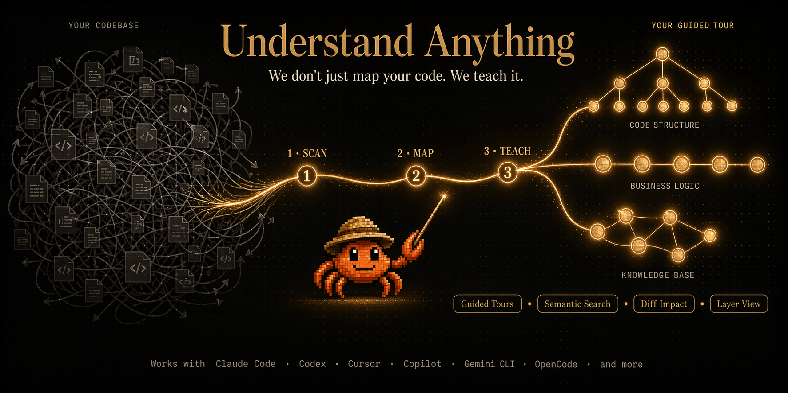

<h1 align="center">เข้าใจทุกสิ่ง</h1>

<p align="center">
  <strong>เปลี่ยนโค้ดเบส ฐานความรู้ หรือเอกสารใด ๆ ให้เป็นกราฟความรู้แบบอินเทอร์แอกทีฟที่คุณสามารถสำรวจ ค้นหา และถามคำถามได้</strong>
  <br />
  <em>ทำงานร่วมกับ Claude Code, Codex, Cursor, Copilot, Gemini CLI และอื่น ๆ</em>
</p>

<p align="center">
  <strong>เข้าใจทุกสิ่ง <a href="https://egonex.ai">เข้าใจทุกคน</a></strong>
  <br />
  <em>AI ควรช่วยเหลือผู้คน ไม่ใช่แทนที่พวกเขา</em>
</p>

<p align="center">
  <a href="https://trendshift.io/repositories/23482" target="_blank"></a>
</p>

<p align="center">
  <a href="README.md">English</a> | <a href="READMEs/README.zh-CN.md">简体中文</a> | <a href="READMEs/README.zh-TW.md">繁體中文</a> | <a href="READMEs/README.ja-JP.md">日本語</a> | <a href="READMEs/README.ko-KR.md">한국어</a> | <a href="READMEs/README.es-ES.md">Español</a> | <a href="READMEs/README.tr-TR.md">Türkçe</a> | <a href="READMEs/README.ru-RU.md">Русский</a>
</p>

<p align="center">
  <a href="#-quick-start"></a>
  <a href="https://github.com/Egonex-AI/Understand-Anything/blob/main/LICENSE"></a>
  <a href="https://docs.anthropic.com/en/docs/claude-code"></a>
  <a href="#codex"></a>
  <a href="#vs-code--github-copilot"></a>
  <a href="#copilot-cli"></a>
  <a href="#gemini-cli"></a>
  <a href="#opencode"></a>
  <a href="#mistral-vibe-cli"></a>
  <a href="#trae"></a>
  <a href="https://understand-anything.com"></a>
  <a href="https://understand-anything.com/demo/"></a>
  <a href="https://egonex.ai"></a>
</p>

<p align="center">
  
</p>

<p align="center">
  <strong>โปรเจกต์โอเพนซอร์สจาก <a href="https://github.com/Egonex-AI">Egonex</a></strong>
  <br />
  <em>สร้างขึ้นครั้งแรกโดย <a href="https://github.com/Lum1104">Lum1104</a></em>
</p>

---

**คุณเพิ่งเข้าร่วมทีมใหม่ โค้ดเบสมีขนาด 200,000 บรรทัด คุณจะเริ่มจากตรงไหน?**

Understand Anything เป็น [Claude Code Plugin](https://code.claude.com/docs/en/plugins-reference#plugins-reference) ที่วิเคราะห์โปรเจกต์ของคุณด้วยไปป์ไลน์หลายเอเจนต์ สร้างกราฟความรู้ของทุกไฟล์ ฟังก์ชัน คลาส และ dependency จากนั้นมอบแดชบอร์ดแบบอินเทอร์แอกทีฟให้คุณสำรวจทั้งหมดด้วยภาพ เลิกอ่านโค้ดแบบเดาสุ่ม เริ่มมองเห็นภาพรวม

> **เป้าหมายไม่ใช่กราฟที่ทำให้คุณทึ่งกับความซับซ้อนของโค้ดเบส แต่เป็นกราฟที่ค่อย ๆ สอนคุณว่าทุกส่วนประกอบกันอย่างไร**

---

## ✨ คุณสมบัติ

> [!NOTE]
> **อยากข้ามการอ่านหรือไม่?** ลองใช้ [live demo](https://understand-anything.com/demo/) ใน [homepage](https://understand-anything.com/) ของเรา — แดชบอร์ดแบบอินเทอร์แอกทีฟเต็มรูปแบบที่คุณสามารถเลื่อน ซูม ค้นหา และสำรวจได้ทันทีในเบราว์เซอร์

### สำรวจกราฟโครงสร้าง

นำทางโค้ดเบสของคุณเป็นกราฟความรู้แบบอินเทอร์แอกทีฟ — ทุกไฟล์ ฟังก์ชัน และคลาสคือโหนดที่คุณสามารถคลิก ค้นหา และสำรวจได้ เลือกโหนดใดก็ได้เพื่อดูสรุปเป็นภาษาอังกฤษง่าย ๆ ความสัมพันธ์ และทัวร์แนะนำ

### เข้าใจตรรกะทางธุรกิจ

สลับไปมุมมองโดเมนและดูว่าโค้ดของคุณ map กับกระบวนการทางธุรกิจจริงอย่างไร — โดเมน โฟลว์ และขั้นตอนที่จัดวางเป็นกราฟแนวนอน

### วิเคราะห์ฐานความรู้

ชี้ `/understand-knowledge` ไปที่ [Karpathy-pattern LLM wiki](https://gist.github.com/karpathy/442a6bf555914893e9891c11519de94f) และรับกราฟความรู้แบบ force-directed พร้อมการจัดกลุ่มชุมชน ตัวแยกวิเคราะห์แบบ deterministic จะดึง wikilink และหมวดหมู่จาก `index.md` จากนั้นเอเจนต์ LLM จะค้นพบความสัมพันธ์โดยนัย ดึงเอนทิตี และเปิดเผยข้อกล่าวอ้าง — เปลี่ยน wiki ของคุณให้เป็นกราฟที่นำทางได้ของแนวคิดที่เชื่อมโยงกัน

<table>
  <tr>
    <td width="50%" valign="top">
      <h3>🧭 ทัวร์แนะนำ</h3>
      <p>การแนะนำสถาปัตยกรรมที่สร้างอัตโนมัติ เรียงตาม dependency เรียนรู้โค้ดเบสในลำดับที่ถูกต้อง</p>
    </td>
    <td width="50%" valign="top">
      <h3>🔍 การค้นหาแบบคลุมเครือและเชิงความหมาย</h3>
      <p>ค้นหาสิ่งใดก็ได้ด้วยชื่อหรือความหมาย ค้นหา "ส่วนใดจัดการ auth?" และรับผลลัพธ์ที่เกี่ยวข้องทั่วทั้งกราฟ</p>
    </td>
  </tr>
  <tr>
    <td width="50%" valign="top">
      <h3>📊 การวิเคราะห์ผลกระทบจากการเปลี่ยนแปลง</h3>
      <p>ดูว่าส่วนใดของระบบที่การเปลี่ยนแปลงของคุณส่งผลกระทบก่อนที่คุณจะ commit เข้าใจผลกระทบที่กระจายไปทั่วโค้ดเบส</p>
    </td>
    <td width="50%" valign="top">
      <h3>🎭 UI ที่ปรับตามบุคคล</h3>
      <p>แดชบอร์ดปรับระดับรายละเอียดตามตัวคุณ — นักพัฒนาระดับ junior, PM หรือผู้ใช้ขั้นสูง</p>
    </td>
  </tr>
  <tr>
    <td width="50%" valign="top">
      <h3>🏗️ การแสดงภาพเลเยอร์</h3>
      <p>จัดกลุ่มอัตโนมัติตามเลเยอร์สถาปัตยกรรม — API, Service, Data, UI, Utility — พร้อมคำอธิบายสี</p>
    </td>
    <td width="50%" valign="top">
      <h3>📚 แนวคิดภาษา</h3>
      <p>12 รูปแบบการเขียนโปรแกรม (generics, closures, decorators ฯลฯ) อธิบายในบริบททุกที่ที่ปรากฏ</p>
    </td>
  </tr>
</table>

---

## 🚀 เริ่มต้นอย่างรวดเร็ว

### 1. ติดตั้งปลั๊กอิน

```bash
/plugin marketplace add Egonex-AI/Understand-Anything
/plugin install understand-anything
```

> **ใช้โมเดลภายในเครื่องอยู่หรือไม่?** สำหรับการตั้งค่าที่เน้นความเป็นส่วนตัวหรือองค์กร ให้ชี้แพลตฟอร์มของคุณไปที่ผู้ให้บริการโมเดลภายในเครื่อง เช่น [Ollama](https://docs.ollama.com/integrations) — ทำตามคู่มือการเชื่อมต่อของพวกเขาเพื่อเปลี่ยนผู้ให้บริการโมเดล

### 2. วิเคราะห์โค้ดเบสของคุณ

```bash
/understand
```

ไปป์ไลน์หลายเอเจนต์จะสแกนโปรเจกต์ของคุณ ดึงทุกไฟล์ ฟังก์ชัน คลาส และ dependency จากนั้นสร้างกราฟความรู้ที่บันทึกไว้ที่ `.ua/knowledge-graph.json` (โปรเจกต์ที่มีไดเรกทอรี `.understand-anything/` อยู่แล้วจะยังคงใช้ไดเรกทอรีนั้น — มันจะยังคงเป็นไดเรกทอรีข้อมูลเมื่อมีอยู่ ดังนั้นจึงไม่จำเป็นต้องย้ายข้อมูลใด ๆ)

> **ข้อควรทราบเกี่ยวกับการใช้โทเคน:** การรัน `/understand` ครั้งแรกจะวิเคราะห์โค้ดเบสทั้งหมดของคุณและอาจใช้โทเคนจำนวนมากในโปรเจกต์ขนาดใหญ่ เราขอแนะนำให้รันบนแผน/การสมัครสมาชิกแบบใช้โทเคน หรือใช้โมเดลภายในเครื่อง (ดูด้านบน) สำหรับการเริ่มต้น การรันครั้งต่อ ๆ ไปจะเป็นแบบ incremental โดยค่าเริ่มต้น — เฉพาะไฟล์ที่เปลี่ยนแปลงเท่านั้นที่จะถูกวิเคราะห์ใหม่ — ดังนั้นจะใช้โทเคนน้อยลงมาก

**ผลลัพธ์ที่แปลเป็นภาษา:** ใช้ `--language` เพื่อสร้างเนื้อหาในภาษาที่คุณต้องการ:

```bash
# Generate Chinese content (知识图节点描述和 Dashboard UI)
/understand --language zh

# Supported languages: en (default), zh, zh-TW, ja, ko, ru
```

ในการรัน **ครั้งแรก** ในโปรเจกต์ — เมื่อคุณไม่ได้ส่ง `--language` และยังไม่มีภาษาที่บันทึกไว้ — `/understand` จะตรวจจับภาษาที่คุณกำลังสนทนาด้วย หากไม่ใช่ภาษาอังกฤษ มันจะถามให้คุณยืนยัน (หรือแทนที่) ก่อนสร้าง การสนทนาภาษาอังกฤษจะไม่ได้รับผลกระทบ ตัวเลือกของคุณจะถูกบันทึกไว้ที่ `.ua/config.json` และนำมาใช้ซ้ำในการรันครั้งต่อ ๆ ไป

พารามิเตอร์ `--language` มีผลต่อ:
- สรุปและคำอธิบายโหนดในกราฟความรู้
- ป้ายกำกับ ปุ่ม และ tooltip ของ UI แดชบอร์ด
- คำอธิบายทัวร์แนะนำ

### 3. สำรวจแดชบอร์ด

```bash
/understand-dashboard
```

แดชบอร์ดเว็บแบบอินเทอร์แอกทีฟจะเปิดขึ้นพร้อมโค้ดเบสของคุณที่แสดงเป็นกราฟ — ใส่รหัสสีตามเลเยอร์สถาปัตยกรรม ค้นหาได้ และคลิกได้ เลือกโหนดใดก็ได้เพื่อดูโค้ด ความสัมพันธ์ และคำอธิบายภาษาอังกฤษง่าย ๆ

### 4. เรียนรู้ต่อไป

```bash
# Ask anything about the codebase
/understand-chat How does the payment flow work?

# Analyze impact of your current changes
/understand-diff

# Deep-dive into a specific file or function
/understand-explain src/auth/login.ts

# Generate an onboarding guide for new team members
/understand-onboard

# Extract business domain knowledge (domains, flows, steps)
/understand-domain

# Analyze a Karpathy-pattern LLM wiki knowledge base
/understand-knowledge ~/path/to/wiki

# Re-run anytime — incremental by default (only re-analyzes changed files)
/understand

# Auto-update on every commit via a post-commit hook
/understand --auto-update

# Scope to a subdirectory (for huge monorepos)
/understand src/frontend
```

---

## 🌐 การติดตั้งหลายแพลตฟอร์ม

Understand-Anything ทำงานได้บนหลายแพลตฟอร์มการเขียนโค้ด AI

### Claude Code (เนทีฟ)

```bash
/plugin marketplace add Egonex-AI/Understand-Anything
/plugin install understand-anything
```


### การติดตั้งบรรทัดเดียว (Codex / OpenCode / OpenClaw / Antigravity / Gemini CLI / Pi Agent / Vibe CLI / VS Code Copilot / Hermes / Cline / KIMI CLI / Trae / Nanobot / Kiro)


**macOS / Linux:**
```bash
curl -fsSL https://raw.githubusercontent.com/Egonex-AI/Understand-Anything/main/install.sh | bash
# or skip the prompt by passing the platform:
curl -fsSL https://raw.githubusercontent.com/Egonex-AI/Understand-Anything/main/install.sh | bash -s codex
```

**Windows (PowerShell):**
```powershell
iwr -useb https://raw.githubusercontent.com/Egonex-AI/Understand-Anything/main/install.ps1 | iex
```

ตัวติดตั้งจะโคลน repo ไปที่ `~/.understand-anything/repo` และสร้าง symlink ที่เหมาะสมสำหรับแพลตฟอร์มที่เลือก รีสตาร์ท CLI/IDE ของคุณหลังจากนั้น

> **หมายเหตุเกี่ยวกับการเรียกใช้ skill:** คำนำหน้าการเรียกใช้แตกต่างกันในแต่ละแพลตฟอร์ม แพลตฟอร์มส่วนใหญ่ใช้ slash command (`/understand`) แต่ **Codex ใช้ `$` แทน** — พิมพ์ `$understand` ไม่ใช่ `/understand` หากไม่มีคำนำหน้าใด recognised บนแพลตฟอร์มของคุณ เพียงถามเป็นภาษาธรรมชาติ: *"ใช้ skill understand เพื่อวิเคราะห์โปรเจกต์นี้"*

- ค่า `<platform>` ที่รองรับ: `gemini`, `codex`, `opencode`, `pi`, `openclaw`, `antigravity`, `vibe`, `vscode`, `hermes`, `cline`, `kimi`, `trae`, `nanobot`, `kiro`
- อัปเดตภายหลัง:
  - macOS / Linux: `./install.sh --update`
  - Windows: `& "$HOME/.understand-anything/repo/install.ps1" -Update`
- ถอนการติดตั้ง:
  - macOS / Linux: `./install.sh --uninstall <platform>`
  - Windows: `& "$HOME/.understand-anything/repo/install.ps1" -Uninstall <platform>`

### Cursor

Cursor จะค้นพบปลั๊กอินอัตโนมัติผ่าน `.cursor-plugin/plugin.json` เมื่อโคลน repo นี้ ไม่จำเป็นต้องติดตั้งด้วยตนเอง — เพียงโคลนและเปิดใน Cursor

หากการค้นหาอัตโนมัติไม่พบ ให้ติดตั้งด้วยตนเอง: เปิด **Cursor Settings → Plugins** วาง `https://github.com/Egonex-AI/Understand-Anything` ลงในช่องค้นหา และเพิ่มจากที่นั่น

### VS Code + GitHub Copilot

VS Code ที่มี GitHub Copilot (v1.108+) จะค้นพบปลั๊กอินอัตโนมัติผ่าน `.copilot-plugin/plugin.json` เมื่อโคลน repo นี้ ไม่จำเป็นต้องติดตั้งด้วยตนเอง — เพียงโคลนและเปิดใน VS Code

สำหรับ personal skill (ใช้ได้กับทุกโปรเจกต์) ให้รัน `install.sh` ข้างต้นด้วยแพลตฟอร์ม `vscode`

### Copilot CLI

```bash
copilot plugin install Egonex-AI/Understand-Anything:understand-anything-plugin
```

### Kiro CLI / IDE

```bash
curl -fsSL https://raw.githubusercontent.com/Egonex-AI/Understand-Anything/main/install.sh | bash -s kiro
```

หลังการติดตั้ง:
- **Kiro CLI**: `kiro-cli chat --agent understand "Analyze this project"`
- **Kiro IDE**: skill ต่าง ๆ ถูก symlink ไปที่ `~/.kiro/skills/` และเอเจนต์ `understand` ถูกเขียนไปที่ `~/.kiro/agents/understand.json` ดังนั้นทั้งสองจะพร้อมใช้งานหลังจากรีสตาร์ท IDE

สำหรับ personal skill (ใช้ได้กับทุกโปรเจกต์) ให้รัน `install.sh` ข้างต้นด้วยแพลตฟอร์ม `kiro`

### ความเข้ากันได้ของแพลตฟอร์ม

| แพลตฟอร์ม | สถานะ | วิธีการติดตั้ง |
|----------|--------|----------------|
| Claude Code | ✅ เนทีฟ | Plugin marketplace |
| Cursor | ✅ รองรับ | Auto-discovery |
| VS Code + GitHub Copilot | ✅ รองรับ | Auto-discovery |
| Copilot CLI | ✅ รองรับ | Plugin install |
| Codex | ✅ รองรับ | `install.sh codex` |
| OpenCode | ✅ รองรับ | `install.sh opencode` |
| OpenClaw | ✅ รองรับ | `install.sh openclaw` |
| Antigravity | ✅ รองรับ | `install.sh antigravity` |
| Gemini CLI | ✅ รองรับ | `install.sh gemini` |
| Pi Agent | ✅ รองรับ | `install.sh pi` |
| Vibe CLI | ✅ รองรับ | `install.sh vibe` |
| Hermes | ✅ รองรับ | `install.sh hermes` |
| Cline | ✅ รองรับ | `install.sh cline` |
| KIMI CLI | ✅ รองรับ | `install.sh kimi` |
| Trae | ✅ รองรับ | `install.sh trae` |
| Nanobot | ✅ รองรับ | `install.sh nanobot` |
| Kiro CLI / IDE | ✅ รองรับ | `install.sh kiro` |


---

## 📦 แชร์กราฟกับทีมของคุณ

กราฟเป็นเพียง JSON — **commit ครั้งเดียว และเพื่อนร่วมทีมข้ามไปป์ไลน์ได้** เหมาะสำหรับการ onboard, การรีวิว PR และ docs-as-code

> **ตัวอย่าง:** [GoogleCloudPlatform/microservices-demo](https://github.com/GoogleCloudPlatform/microservices-demo) — ตัวอย่าง Go / Java / Python / Node ที่มีกราฟ commit ไว้

**สิ่งที่ต้อง commit:** ทุกอย่างใน `.ua/` *ยกเว้น* `intermediate/` และ `diff-overlay.json` (สิ่งเหล่านี้เป็นไฟล์ชั่วคราวในเครื่อง) (โปรเจกต์เก่าใช้ `.understand-anything/` — ให้แทนที่ชื่อไดเรกทอรีด้านล่างหากเป็นไดเรกทอรีที่ปรากฏ)

```gitignore
.ua/intermediate/
.ua/diff-overlay.json
```

**ทำให้สดใหม่เสมอ:** เปิดใช้ `/understand --auto-update` — post-commit hook จะ patch กราฟแบบ incremental ดังนั้นแต่ละ commit จะมาพร้อมกราฟที่ตรงกัน หรือรัน `/understand` ด้วยตนเองก่อน release

**กราฟขนาดใหญ่ (10 MB+):** ติดตามด้วย **git-lfs**

```bash
git lfs install
git lfs track ".ua/*.json"
git add .gitattributes .ua/
```

### ดูแดชบอร์ดโดยไม่ใช้ Claude Code

เมื่อกราฟถูกสร้างและ commit แล้ว ใครก็ตามในทีมสามารถเปิดได้ด้วยคำสั่งเดียว — ไม่ต้องใช้ Claude Code, ไม่ต้องใช้ LLM, ไม่ต้องใช้ API key ต้องการเพียง Node.js (>= 18):

```bash
npx https://github.com/Egonex-AI/Understand-Anything/releases/latest/download/understand-anything-viewer.tgz /path/to/analyzed/project
```

เทอร์มินัลจะพิมพ์ URL ที่มี token (`http://127.0.0.1:5173/?token=…`) และเปิดแดชบอร์ดแบบอินเทอร์แอกทีฟเต็มรูปแบบในเบราว์เซอร์ของคุณ ไดเรกทอรีโปรเจกต์ (ค่าเริ่มต้น: ไดเรกทอรีปัจจุบัน) ต้องมีไดเรกทอรีข้อมูลที่ commit ไว้ (`.ua/` หรือ `.understand-anything/` แบบเก่า) ทุกอย่างถูกให้บริการแบบอ่านอย่างเดียวจากดิสก์ในเครื่อง — ไม่มีการเรียก LLM ไม่มีข้อมูลออกจากเครื่องของคุณ

ทำงานจาก clone แทนหรือไม่? `pnpm install && pnpm --filter @understand-anything/core build` จากนั้น `GRAPH_DIR=/path/to/analyzed/project pnpm dev:dashboard` จะทำเช่นเดียวกันผ่าน Vite dev server

---

## 🔧 เบื้องหลังการทำงาน

### Tree-sitter + LLM แบบผสม

การวิเคราะห์แบบ static และ LLM ทำงานในสิ่งที่แต่ละอย่างถนัดที่สุด:

- **Tree-sitter (deterministic)** — แยกวิเคราะห์ซอร์สเป็น concrete syntax tree และดึงข้อเท็จจริงเชิงโครงสร้าง: import, export, นิยามฟังก์ชัน/คลาส, จุดเรียกใช้, การสืบทอด แก้ไขล่วงหน้าเป็น `importMap` ในระหว่างขั้นตอนการสแกนและส่งไปยัง file-analyzer เพื่อไม่ให้พวกมันต้องหาค่า import จากซอร์สซ้ำอีก ข้อมูลเข้าเดียวกัน → ผลลัพธ์เดียวกัน ทุกครั้งที่รัน ยังช่วยตรวจจับการเปลี่ยนแปลงโดยใช้ fingerprint สำหรับการอัปเดตแบบ incremental
- **LLM (semantic)** — อ่านโครงสร้างที่แยกวิเคราะห์แล้วพร้อมกับซอร์สต้นฉบับเพื่อสร้างสิ่งที่ parser ทำไม่ได้: สรุปเป็นภาษาอังกฤษง่าย ๆ, แท็ก, การกำหนดเลเยอร์สถาปัตยกรรม, การ map โดเมนธุรกิจ, ทัวร์แนะนำ, คำอธิบายแนวคิดภาษา

การแยกส่วนนี้เป็นเหตุผลที่กราฟสามารถทำซ้ำได้ในด้านโครงสร้าง (โค้ดเดียวกันให้ edge เดียวกันเสมอ) ในขณะที่ยังคงจับเจตนาในด้านความหมาย (ว่าไฟล์นั้น *มีไว้เพื่ออะไร* ไม่ใช่แค่สิ่งที่มัน import)

### ไปป์ไลน์หลายเอเจนต์

คำสั่ง `/understand` ประสานงานเอเจนต์เฉพาะทาง 5 ตัว, `/understand-domain` เพิ่มตัวที่ 6 และ `/understand-knowledge` เพิ่มตัวที่ 7:

| เอเจนต์                 | บทบาท                                                                                                               | ใช้โดย                 |
| ----------------------- | ------------------------------------------------------------------------------------------------------------------ | ----------------------- |
| `project-scanner`       | ค้นหาไฟล์ ตรวจจับภาษาและเฟรมเวิร์ก                                                                                  | `/understand`           |
| `file-analyzer`         | ดึงฟังก์ชัน คลาส import; สร้างโหนดและ edge ของกราฟ                                                                 | `/understand`           |
| `architecture-analyzer` | ระบุเลเยอร์สถาปัตยกรรม                                                                                              | `/understand`           |
| `tour-builder`          | สร้างทัวร์การเรียนรู้แบบมีแนะนำ                                                                                      | `/understand`           |
| `graph-reviewer`        | ตรวจสอบความสมบูรณ์ของกราฟและความถูกต้องของการอ้างอิง ทำงานแบบ inline โดยค่าเริ่มต้น; ใช้ `--review` สำหรับการรีวิว LLM แบบเต็ม | `/understand`           |
| `domain-analyzer`       | ดึงโดเมนธุรกิจ โฟลว์ และขั้นตอนกระบวนการ                                                                            | `/understand-domain`    |
| `article-analyzer`      | ดึงเอนทิตี ข้อกล่าวอ้าง และความสัมพันธ์โดยนัยจากบทความ wiki                                                          | `/understand-knowledge` |

ตัววิเคราะห์ไฟล์ทำงานแบบขนาน สูงสุด 5 worker พร้อมกัน และ 20–30 ไฟล์ต่อแบตช์

ไปป์ไลน์ยังรองรับการอัปเดตแบบ incremental: เฉพาะไฟล์ที่เปลี่ยนแปลงตั้งแต่การรันครั้งล่าสุดเท่านั้นที่จะถูกวิเคราะห์ใหม่


---

## 🎥 ชุมชน

วิดีโอแนะนำที่สร้างโดยชุมชนโดย **Better Stack**

<p align="center">
  <a href="https://www.youtube.com/watch?v=VmIUXVlt7_I"></a>
  <br />
  <em><a href="https://www.youtube.com/watch?v=VmIUXVlt7_I">ดูบน YouTube &rarr;</a></em>
</p>

สร้างวิดีโอ บล็อกโพสต์ หรือบทช่วยสอนหรือไม่? เปิด issue หรือ PR — ยินดีที่จะนำมาแสดงที่นี่

---

## 🤝 การมีส่วนร่วม

ยินดีรับการมีส่วนร่วม! นี่คือวิธีเริ่มต้น:

1. Fork repository
2. สร้าง feature branch (`git checkout -b feature/my-feature`)
3. รันการทดสอบ (`pnpm --filter @understand-anything/core test`)
4. Commit การเปลี่ยนแปลงของคุณและเปิด pull request

โปรดเปิด issue ก่อนสำหรับการเปลี่ยนแปลงครั้งใหญ่เพื่อให้เราพูดคุยแนวทางได้

---

<p align="center">
  <strong>เลิกอ่านโค้ดแบบเดาสุ่ม เริ่มเข้าใจทุกสิ่ง</strong>
</p>

## ประวัติดาว

<a href="https://www.star-history.com/?repos=Egonex-AI%2FUnderstand-Anything&type=date&legend=top-left">
 <picture>
   <source media="(prefers-color-scheme: dark)" srcset="https://api.star-history.com/image?repos=Egonex-AI/Understand-Anything&type=date&theme=dark&legend=top-left" />
   <source media="(prefers-color-scheme: light)" srcset="https://api.star-history.com/image?repos=Egonex-AI/Understand-Anything&type=date&legend=top-left" />
   
 </picture>
</a>

<p align="center">
  <em>ขอบคุณทุกคนที่ใช้และมีส่วนร่วม — การรู้ว่าสิ่งนี้ช่วยประหยัดเวลาผู้คนคือสิ่งที่ทำให้มันคุ้มค่าที่จะสร้าง</em>
</p>

<p align="center">
  MIT License &copy; Yuxiang Lin และ Infinite Universe, Inc.
</p>