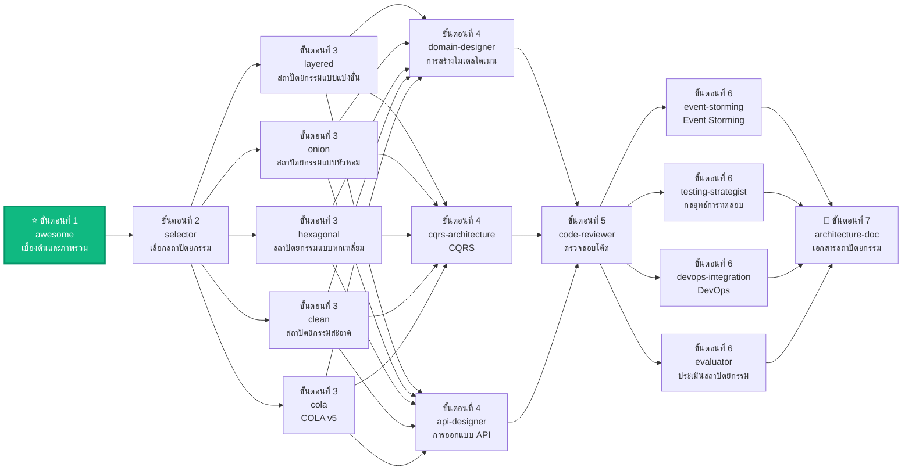

# DDD Architecture Awesome

**จุดเริ่มต้น** ของระบบนิเวศ DDD Skills สกิลนี้ให้ทุกสิ่งที่จำเป็นในการทำความเข้าใจ DDD ตัดสินใจว่ามันเหมาะกับโปรเจกต์ของคุณหรือไม่ และวางแผนเส้นทางการเรียนรู้ — ทั้งหมดในที่เดียว

## เมื่อใดควรใช้ (และเมื่อใดไม่ควร)

| ✅ ใช้เมื่อ | ❌ ข้ามเมื่อ |
|------------|-------------|
| โดเมนธุรกิจที่ซับซ้อนมีกฎหลายข้อ | CRUD ง่ายๆ มีกฎธุรกิจน้อย |
| ระบบที่อยู่ยาวนาน (บำรุงรักษาหลายปี) | ต้นแบบ, MVP, โค้ดชั่วคราว |
| ทีม 5+ นักพัฒนา | นักพัฒนาคนเดียวหรือทีมเล็ก (1-2) |
| มีทางเข้าหลายทาง (API, CLI, events) | ทางเข้าเดียว, API ง่าย |
| ต้องการสลับโครงสร้างพื้นฐาน (DB, broker) | โครงสร้างพื้นฐานคงที่ ไม่น่าจะเปลี่ยน |
| ต้องการความครอบคลุมการทดสอบสูง | สคริปต์เร็วๆ, เครื่องมือภายใน |
| สแต็ก Spring Boot + MyBatis ขององค์กรจีน | ใช้สถาปัตยกรรมที่establishedและทำงานได้อยู่แล้ว |

**เริ่มจากง่ายๆ พัฒนาความซับซ้อนเมื่อจำเป็นเท่านั้น** ระบบส่วนใหญ่ไม่ต้องการ CQRS หรือ Event Sourcing เต็มรูปแบบ

## เมื่อใดควรทริกเกอร์สกิลนี้

**ใช้สกิลนี้เสมอเมื่อผู้ใช้กล่าวถึง:**
- "What is DDD", "Explain DDD", "DDD คืออะไร", "แนะนำ DDD"
- "Domain-Driven Design", "การออกแบบที่ขับเคลื่อนด้วยโดเมน"
- "DDD basics", "DDD fundamentals", "พื้นฐาน DDD", "เริ่มต้น DDD"
- "Should I use DDD", "สถานการณ์ที่เหมาะสมกับ DDD", "DDD เหมาะสมหรือไม่"
- "DDD vs CRUD", "DDD vs traditional", "เปรียบเทียบ DDD"
- "DDD concepts", "แนวคิด DDD"
- "Strategic design DDD", "Tactical design DDD", "การออกแบบเชิงกลยุทธ์ DDD", "การออกแบบเชิงยุทธวิธี DDD"
- "When to apply DDD", "When DDD is appropriate"
- คำถามเกี่ยวกับประเภทสถาปัตยกรรม DDD และความแตกต่าง
- ใหม่กับ DDD และต้องการคำแนะนำว่าจะเริ่มจากไหน
---

## 1. ความหมายของ DDD

> Domain-Driven Design คือระเบียบวิธีพัฒนาที่นำกฎธุรกิจที่ซับซ้อนเข้าสู่โดเมนโมเดล: กำหนดขอบเขตธุรกิจก่อน (Strategic Design) จากนั้นเข้ารหัสกฎลงในโมเดล (Tactical Design)

**ข้อมูลเชิงลึกสำคัญ**: DDD ไม่เกี่ยวกับเทคโนโลยี — มันเกี่ยวกับการทำให้โค้ดของคุณสอดคล้องกับวิธีที่ธุรกิจคิด

---

## 2. แผนผังการตัดสินใจความเหมาะสมของ DDD

**ประเมินตามมิติเหล่านี้และให้ข้อสรุป "เหมาะสม / ระวัง / ไม่แนะนำ":**

| มิติ | เหมาะสม (✓) | ระวัง (~) | ไม่แนะนำ (✗) |
|-----------|-------------|-------------|---------------------|
| **ความซับซ้อนทางธุรกิจ** | กฎซับซ้อน, state machine, การประสานงานข้ามทีม | มีกฎธุรกิจบ้าง ส่วนใหญ่เรียบง่าย | CRUD ล้วน, การป้อนข้อมูล |
| **วงจรชีวิต** | อยู่ยาวนาน, วิวัฒน์ต่อเนื่อง | ระยะกลาง, มีการทำซ้ำบ้าง | ระยะสั้น, ใช้แล้วทิ้ง |
| **วุฒิภาวะของทีม** | มีผู้เชี่ยวชาญโดเมนเฉพาะ, PM ที่มั่นคง | มีความรู้ธุรกิจทั่วไป | ไม่มีความรู้โดเมน |
| **ความสามารถทางวิศวกรรม** | การทดสอบ/observability ที่แข็งแกร่ง, พร้อม event-driven | CI/CD พื้นฐาน, มีการทดสอบบ้าง | ไม่มีโครงสร้างพื้นฐานการทดสอบ |

### ผังการตัดสินใจ

```
ตรรกะทางธุรกิจซับซ้อนหรือไม่ (กฎ, state machine, ข้อจำกัด)?
├── ไม่ → ระบบอยู่ยาวนาน (> 2 ปี)?
│         ├── ไม่ → ✗ ไม่แนะนำ DDD (ใช้ CRUD + Service ง่ายๆ)
│         └── ใช่ → ~ ระวัง: นำแพตเทินเชิงยุทธวิธีมาใช้แบบเลือกสรร
│
└── ใช่ → มีผู้เชี่ยวชาญโดเมนหรือเจ้าของผลิตภัณฑ์ที่มั่นคง?
          ├── ไม่ → ~ ระวัง: DDD โดยไม่มีผู้เชี่ยวชาญโดเมน = โค้ดซับซ้อนโดยเปล่าประโยชน์
          └── ใช่ → ทีมคุ้นเคยกับ DDD หรือยินดีเรียนรู้?
                    ├── ไม่ → ~ ระวัง: เริ่มจาก Layered แล้วค่อยวิวัฒน์
                    └── ใช่ → ต้องการสลับโครงสร้างพื้นฐาน (DB, MQ)?
                              ├── ไม่ → ✓ แนะนำ DDD (COLA หรือ Layered)
                              └── ใช่ → ✓ แนะนำ DDD อย่างยิ่ง (Hexagonal/Clean)
```

---

## 3. บันไดความซับซ้อน — อย่าข้ามระดับ

**แต่ละระดับเพิ่มความซับซ้อนจริง ขยับขึ้นเฉพาะเมื่อพิสูจน์แล้วว่าระดับปัจจุบันไม่เพียงพอ**

```
ระดับ 1: Simple Layered (Controller → Service → Repository)
   ↓ เมื่อกฎธุรกิจซับซ้อนขึ้นและต้องการการสร้างโมเดลอย่างชัดเจน
ระดับ 2: DDD 4-Layer with Rich Domain Model (Layered)
   ↓ เมื่อต้องการทางเข้าหลายทาง (REST + CLI + MQ + gRPC)
ระดับ 3: Ports & Adapters (Hexagonal Architecture)
   ↓ เมื่อรูปแบบการอ่าน/เขียนแตกต่างกันอย่างมีนัยสำคัญ
ระดับ 4: CQRS — แยกโมเดลอ่าน/เขียน
   ↓ เมื่อต้องการบันทึกการตรวจสอบที่สมบูรณ์ / การสอบถามเชิงเวลา
ระดับ 5: Event Sourcing — เก็บเหตุการณ์, สร้างสถานะ

ระดับโปรเจกต์ของคุณ: ___ (แนะนำพร้อมเหตุผล)
```

---

## 4. ขอบเขตของแพตเทิน — แต่ละแพตเทินคืออะไรและไม่ใช่อะไร

ตารางนี้แก้ความสับสนที่พบบ่อยที่สุดใน DDD: "อะไรคือความแตกต่างระหว่างแพตเทินเหล่านี้ และเมื่อใดควรใช้แต่ละอัน?"

| แพตเทิน | คำถามหลัก | ใช้สำหรับ | อย่ามองว่าเป็น |
|---------|-----------------|------------|-----------------|
| **DDD** | เราสร้างโมเดลโดเมนธุรกิจที่ซับซ้อนได้อย่างไร? | ภาษาสากล, bounded contexts, aggregates, value objects | โครงสร้างโฟลเดอร์เพียงอย่างเดียว |
| **Hexagonal Architecture** | แอปพลิเคชันมีปฏิสัมพันธ์กับโลกภายนอกอย่างไร? | Ports, driver adapters, driven adapters, แกนแอปพลิเคชันที่ทดสอบได้ | คำสั่งให้มีหกด้านหรือรูปแบบแพ็กเกจเดียวที่แน่นอน |
| **Clean Architecture** | การพึ่งพาควรชี้ไปในทิศทางใด? | กฎการพึ่งพาเข้าด้านใน, ขอบเขต use case, ความเป็นอิสระจากเฟรมเวิร์ก | เทมเพลตสี่โฟลเดอร์สากล |
| **Onion Architecture** | เราทำให้โดเมนโมเดลเป็นศูนย์กลางได้อย่างไร? | เลเยอร์ที่เน้นโดเมนและการกลับทิศทางการพึ่งพา | ข้อกำหนดแยกเมื่อ Clean/Hexagonal แก้ปัญหาแล้ว |
| **COLA v5** | เราทำมาตรฐาน DDD ในทีม Java องค์กรได้อย่างไร? | สถาปัตยกรรมเพชร, การ scaffolding, การตรวจสอบสถาปัตยกรรมอัตโนมัติ | กระสุนวิเศษสำหรับทุกโปรเจกต์ |
| **Layered Architecture** | เรานำ DDD มาใช้ทีละน้อยได้อย่างไร? | การแยก 4 ชั้น, รบกวนโปรเจกต์ 3 ชั้นที่มีอยู่น้อยที่สุด | จุดหมายปลายทางถาวร (วิวัฒน์เมื่อพร้อม) |
| **CQRS** | การอ่านและการเขียนต้องการโมเดลที่แตกต่างกันหรือไม่? | Bounded contexts ที่ภาระงานอ่าน/เขียนแตกต่างกัน | สถาปัตยกรรมเริ่มต้นของแอปพลิเคชัน |
| **Event Sourcing** | เราต้องการสถานะจากประวัติเหตุการณ์ที่สมบูรณ์หรือไม่? | การบันทึกการตรวจสอบ, การสอบถามเชิงเวลา, เวิร์กโฟลว์ที่เล่นซ้ำได้ | ค่าเริ่มต้นการคงอยู่สำหรับระบบ CRUD |

---

## 5. ภาพรวมสถาปัตยกรรม DDD

```
ตระกูลสถาปัตยกรรม DDD:

  พื้นฐาน (ค่าเรียนรู้: ต่ำ → กลาง):
  ├── Layered Architecture (分层架构)
  │   └── 4 ชั้นคลาสสิก: Interface → Application → Domain ← Infrastructure
  │       1-5 คน | เหมาะกับ CRUD | Spring Boot พื้นเมือง
  │
  ├── Onion Architecture (洋葱架构)
  │   └── แกนโดเมน, วงแหวนการพึ่งพาแบบศูนย์กลาง, ชั้นในกำหนดอินเทอร์เฟซ
  │       5-15 คน | ความสามารถทดสอบสูง | เปลี่ยนแปลง infra บ่อย
  │
  ├── Hexagonal Architecture (六边形架构 / Ports & Adapters)
  │   └── โดเมนอยู่ตรงกลาง, ports กำหนดสัญญา, adapters นำไปใช้
  │       5-15 คน | ระบบหลายทางเข้า | ความสามารถทดสอบดีที่สุด
  Advanced (ค่าเรียนรู้: กลาง → สูง):
  ├── Clean Architecture (整洁架构)
  │   └── Entities → Use Cases → Interface Adapters → Frameworks
  │       15-50 คน | ระบบองค์กร | การแยกโมดูลที่เข้มงวด
  │
  └── COLA Architecture (COLA v5 架构)
      └── รูปแบบเพชร: Adapter → App → Domain ← Infrastructure
          5-50 คน | องค์กรจีน | เครื่องมือและชุมชนดีที่สุด

  แพตเทินเสริม:
  ├── CQRS — แยกโมเดลอ่าน/เขียน (L1: โมเดลเท่านั้น / L2: แยก DB / L3: Event Sourcing)
  ├── Domain Events — ความสอดคล้องแบบ eventual ข้าม aggregate
  └── Event Sourcing — เก็บเหตุการณ์เป็นแหล่งความจริง
```

### การเปรียบเทียบสถาปัตยกรรมด้วยภาพ

```
Layered        Onion        Hexagonal      Clean          COLA v5
┌────────┐   ┌──────────┐  ┌──────────┐  ┌──────────┐  ┌──────────┐
│Interf. │   │ Infra    │  │ Adapter  │  │ Frame.   │  │ Adapter  │
├────────┤   │ ┌──────┐ │  ├──────────┤  ├──────────┤  ├──────────┤
│  App   │   │ │ App  │ │  │  Ports   │  │ Adapter  │  │   App    │
├────────┤   │ │┌────┐│ │  ├──────────┤  ├──────────┤  ├──────────┤
│ Domain │   │ ││Dom.││ │  │ Domain ★ │  │ Domain ★ │  │ Domain ★ │
├────────┤   │ ││ ★  ││ │  └──────────┘  └──────────┘  ├──────────┤
│ Infra  │   │ │└────┘│ │                              │ Infra    │
└────────┘   │ └──────┘ │                              └──────────┘
             └──────────┘
```

---

## 6. เอกสารอ้างอิงด่วนแนวคิดหลัก DDD

### 6.1 Strategic Design (การออกแบบเชิงกลยุทธ์)

| แนวคิด | ความหมาย | ประเด็นสำคัญ |
|---------|-----------|-----------|
| **Bounded Context** | ขอบเขตที่โมเดลโดเมนมีความสอดคล้อง | แต่ละ context มีภาษาสากลของตัวเอง |
| **Ubiquitous Language** | ภาษาที่ใช้ร่วมกันระหว่างนักพัฒนาและผู้เชี่ยวชาญโดเมน | ใช้ในโค้ด, บทสนทนา, และเอกสาร |
| **Context Mapping** | ความสัมพันธ์ระหว่าง bounded contexts | Partnership, Shared Kernel, Customer-Supplier, ACL, OHS |
| **Core Domain** | ส่วนที่สำคัญที่สุดของธุรกิจ | ลงทุนความพยายามมากที่สุดที่นี่ |
| **Subdomain** | ความสามารถทางธุรกิจเสริมหรือทั่วไป | Core / Supporting / Generic |

### 6.2 Tactical Design (การออกแบบเชิงยุทธวิธี)

| แพตเทิน | วัตถุประสงค์ | กฎสำคัญ |
|---------|---------|----------|
| **Entity** | ออบเจ็กต์ที่มีตัวตนคงอยู่ | ความเท่าเทียมตาม ID ไม่ใช่ตามคุณสมบัติ |
| **Value Object** | ข้อมูลที่ไม่เปลี่ยนรูปกำหนดโดยคุณสมบัติ | ความเท่าเทียมตามค่า ไม่มี setters |
| **Aggregate** | ขอบเขตความสอดคล้อง | หนึ่ง aggregate = หนึ่ง transaction |
| **Aggregate Root** | จุดเข้าเดียวของ aggregate | มีเพียง root ที่ถูกอ้างอิงจากภายนอก |
| **Repository** | นามธรรมการคงอยู่ | หนึ่ง repository ต่อหนึ่ง aggregate |
| **Domain Service** | ตรรกะข้ามเอนทิตีที่ไม่มีสถานะ | เมื่อตรรกะไม่เข้ากับเอนทิตีใด |
| **Domain Event** | บันทึกการเปลี่ยนแปลงที่มีความหมาย | ตั้งชื่ออดีต (OrderPaid) |
| **Factory** | การสร้างออบเจ็กต์ที่ซับซ้อน | เมื่อ constructor ไม่เพียงพอ |
| **Specification** | กฎธุรกิจที่ประกอบได้ | รวม AND/OR/NOT ได้ |

### 6.3 ผังการตัดสินใจแบบเร็ว

#### "โค้ดนี้ไปที่ไหน?"

```
โค้ดนี้ไปที่ไหน?
├─ ตรรกะธุรกิจล้วน ไม่มี I/O           → domain/
├─ ประสานงานโดเมน + มี side effects     → application/
├─ สื่อสารกับระบบภายนอก                 → infrastructure/
├─ กำหนดวิธีมีปฏิสัมพันธ์ (interface)   → port (domain หรือ application)
└─ นำ port ไปใช้                        → adapter (infrastructure)
```

#### "Entity หรือ Value Object?"

```
Entity หรือ Value Object?
├─ มีตัวตนเฉพาะที่คงอยู่ → Entity
├─ กำหนดโดยคุณสมบัติเท่านั้น → Value Object
├─ "นี่คือสิ่งเดียวกันหรือไม่?" → Entity (เปรียบเทียบตัวตน)
└─ "สิ่งนี้มีค่าเดียวกันหรือไม่?" → Value Object (ความเท่าเทียมเชิงโครงสร้าง)
```

#### "สิ่งนี้ควรเป็น Aggregate ของตัวเองหรือไม่?"

```
ขอบเขต Aggregate?
├─ ต้องสอดคล้องกันใน transaction เดียว → Aggregate เดียวกัน
├─ สามารถ eventual consistent ได้      → แยก Aggregate
├─ อ้างอิงด้วย ID เท่านั้น              → แยก Aggregate
└─ >10 เอนทิตีใน aggregate              → แยกมัน
```

**กฎ:** หนึ่ง aggregate ต่อ transaction ความสอดคล้องข้าม aggregate ผ่าน domain events (eventual consistency)

---

## 7. Rich Domain Model vs Anemic CRUD (ความแตกต่างที่สำคัญ)

```java
// ❌ Anemic Model (Anti-Pattern) — ถุงข้อมูล + Service
@Entity
public class Order {
    private Long id;
    private String status;       // String แทน Value Object
    // มีแค่ getters/setters ไม่มี behavior
}

@Service
public class OrderService {       // God Service ที่มีตรรกะทั้งหมด
    @Transactional
    public void pay(Long orderId) {
        Order order = orderRepo.findById(orderId);
        if ("DRAFT".equals(order.getStatus())) {  // เปรียบเทียบ string ดิบ
            order.setStatus("PAID");
            orderRepo.save(order);
        }
    }
}

// ✅ Rich Domain Model (DDD) — Behavior อยู่กับ data
public class Order extends AggregateRoot<OrderId> {
    private OrderStatus status;      // Value Object
    private Money totalAmount;
    private List<OrderItem> items;

    public void pay() {              // Behavior ในเอนทิตี
        if (!status.canPay()) {
            throw new OrderException("Cannot pay in current status");
        }
        this.status = OrderStatus.PAID;
        addDomainEvent(new OrderPaidEvent(this.id));
    }
}
```

### ฮิวริสติกการกำหนดขนาด Aggregate

| เมตริก | สุขภาพดี | คำเตือน | การดำเนินการ |
|--------|---------|---------|--------|
| เอนทิตีต่อ aggregate | 1-5 | 6-10 | >10: แยก |
| บรรทัดโค้ด (root) | <500 | 500-1000 | >1000: แยก |
| เวลาล็อก transaction | <100ms | 100-500ms | >500ms: แยก |
| ความขัดแย้งในการแก้ไขพร้อมกัน | นานๆ ครั้ง | เป็นครั้งคราว | บ่อย: แยก |

---

## 8. แอนติแพตเทิน (สำคัญ — พร้อมวิธีแก้ไข)

| แอนติแพตเทิน | ปัญหา | วิธีแก้ไข |
|-------------|---------|-----|
| **Anemic Domain Model** | เอนทิตีเป็นถุงข้อมูล ตรรกะอยู่ใน service | ย้าย behavior เข้าไปในเอนทิตี |
| **Repository per Table** | ทำลายขอบเขต aggregate | หนึ่ง repository ต่อหนึ่ง AGGREGATE |
| **Leaking Infrastructure** | โดเมน import ไลบรารี DB/HTTP | โดเมนไม่มีการพึ่งพาภายนอกเลย |
| **God Aggregate** | เอนทิตีมากเกินไป transaction ช้า | แยกเป็น aggregate เล็กลง |
| **Skipping Use Cases** | Controller เรียก repository โดยตรง | ส่งผ่าน application use cases |
| **CRUD Thinking** | สร้างโมเดลข้อมูล ไม่ใช่ behavior | สร้างโมเดลการดำเนินการทางธุรกิจ |
| **Premature CQRS** | เพิ่มความซับซ้อนก่อนจำเป็น | เริ่มง่ายๆ ค่อยวิวัฒน์ |
| **Cross-Aggregate TX** | หลาย aggregate ใน transaction เดียว | ใช้ domain events เพื่อความสอดคล้อง |
| **DDD without Domain Expert** | สถาปัตยกรรมไม่มีข้อมูลเชิงลึกทางธุรกิจ | DDD โดยไม่มีผู้เชี่ยวชาญ = โค้ดซับซ้อน |
| **Framework-First Thinking** | เลือกเทคโนโลยีก่อนเข้าใจโดเมน | โดเมนก่อน เทคโนโลยีทีหลัง |

---

## 9. ลำดับการนำไปใช้ (สากล)

```
1. ค้นพบโดเมน — Event Storming, บทสนทนากับผู้เชี่ยวชาญโดเมน
2. สร้างโมเดลโดเมน — Entities, value objects, aggregates (ไม่มี infrastructure)
3. กำหนด Ports — อินเทอร์เฟซ Repository, อินเทอร์เฟซบริการภายนอก
4. นำ Use Cases ไปใช้ — Application services ประสานงานโดเมน
5. เพิ่ม Adapters สุดท้าย — HTTP, ฐานข้อมูล, การนำ messaging ไปใช้

DDD เป็นความร่วมมือ เซสชันการสร้างโมเดลกับผู้เชี่ยวชาญโดเมนสำคัญพอๆ กับแพตเทินโค้ด
```

---

## 10. วิธีใช้สกิลนี้

### ขั้นตอนที่ 1: เข้าใจบริบทของผู้ใช้
ถามเกี่ยวกับ: ลักษณะโปรเจกต์, ความซับซ้อนทางธุรกิจ, โครงสร้างทีม, สถานะปัจจุบัน

### ขั้นตอนที่ 2: ประเมินความเหมาะสมของ DDD
ดำเนินการตามแผนผังการตัดสินใจ (ส่วนที่ 2) และ輸出:
- **เหมาะสม**: ดำเนินการเลือกสถาปัตยกรรม
- **ระวัง**: แนะนำการนำไปใช้แบบเลือกสรร
- **ไม่แนะนำ**: อธิบายเหตุผล ป้องกันการออกแบบเกินจำเป็น

### ขั้นตอนที่ 3: แนะนำเส้นทางการเรียนรู้

| ประเภทผู้ใช้ | เส้นทางที่แนะนำ |
|-----------|-----------------|
| **ผู้เริ่ม DDD** | awesome → selector → (สกิลสถาปัตยกรรม) → code-reviewer |
| **สถาปนิก/Tech Lead** | selector → (สกิลสถาปัตยกรรม) → domain-designer → doc |
| **ย้ายไป DDD** | awesome → selector → (สกิลสถาปัตยกรรม) → reviewer → evaluator |
| **Layered** | selector → architecture-layered → domain-designer |
| **Onion** | selector → architecture-onion → domain-designer |
| **Hexagonal** | selector → architecture-hexagonal → domain-designer + api-designer |
| **Clean** | selector → architecture-clean → domain-designer |
| **COLA** | selector → architecture-cola → domain-designer → api-designer |
| **ต้องการ CQRS** | selector → cqrs-architecture (เดี่ยวหรือฝังในสถาปัตยกรรม) |
| **Microservices + Events** | selector → (สกิลสถาปัตยกรรม) → cqrs-architecture → api-designer |
| **ตรวจสอบโค้ด** | code-reviewer (เดี่ยว) |
| **ประเมินสถาปัตยกรรม** | evaluator (เป็นระยะ) |
| **เอกสารสถาปัตยกรรม** | doc (เดี่ยว, อ่านโค้ดที่มีอยู่) |
| **Event Storming Workshop** | event-storming (เดี่ยวหรือคู่กับ domain-designer) |
| **กลยุทธ์การทดสอบ** | testing-strategist (เดี่ยวหรือคู่กับสกิลสถาปัตยกรรม) |
| **การรวม DevOps** | devops-integration (คู่กับ CI/CD pipeline) |

### ขั้นตอนที่ 4: รูปแบบผลลัพธ์

จัดโครงสร้างการตอบกลับด้วย:
1. **การประเมินความเหมาะสม** — ข้อสรุปชัดเจน + เหตุผลตามมิติ
2. **เอกสารอ้างอิงด่วนแนวคิดหลัก DDD** — ปรับให้เหมาะกับบริบท
3. **เส้นทางการเรียนรู้ที่แนะนำ** — สกิลใด, ลำดับใด

---

## 11. แหล่งอ้างอิง

### แหล่งต้นฉบับ — เอกสารและหนังสือต้นฉบับ
- [Domain-Driven Design: The Blue Book](https://www.domainlanguage.com/ddd/blue-book/) — Eric Evans (2003)
- [Implementing Domain-Driven Design](https://openlibrary.org/works/OL17392277W) — Vaughn Vernon (2013)
- [Hexagonal Architecture](https://alistair.cockburn.us/hexagonal-architecture/) — Alistair Cockburn (2005)
- [The Clean Architecture](https://blog.cleancoder.com/uncle-bob/2012/08/13/the-clean-architecture.html) — Robert C. Martin (2012)
- [Onion Architecture](https://jeffreypalermo.com/2008/07/the-onion-architecture-part-1/) — Jeffrey Palermo (2008)

### เอกสารอ้างอิงแพตเทินต้นฉบับ
- [CQRS](https://martinfowler.com/bliki/CQRS.html) — Martin Fowler
- [Event Sourcing](https://martinfowler.com/eaaDev/EventSourcing.html) — Martin Fowler
- [Repository Pattern](https://martinfowler.com/eaaCatalog/repository.html) — Martin Fowler (PoEAA)
- [Unit of Work](https://martinfowler.com/eaaCatalog/unitOfWork.html) — Martin Fowler (PoEAA)
- [Bounded Context](https://martinfowler.com/bliki/BoundedContext.html) — Martin Fowler
- [Effective Aggregate Design](https://www.dddcommunity.org/library/vernon_2011/) — Vaughn Vernon

### คู่มือการนำไปใช้
- [Microsoft: DDD + CQRS Microservices](https://learn.microsoft.com/en-us/dotnet/architecture/microservices/microservice-ddd-cqrs-patterns/)
- [Domain Events – Salvation](https://udidahan.com/2009/06/14/domain-events-salvation/) — Udi Dahan
- [Transactional Outbox](https://microservices.io/patterns/data/transactional-outbox.html) — microservices.io
- [Introducing Event Storming](https://www.eventstorming.com/) — Alberto Brandolini
- [C4 Model](https://c4model.com/) — Simon Brown
- [Documenting Architecture Decisions](https://cognitect.com/blog/2011/11/15/documenting-architecture-decisions) — Michael Nygard

### การสังเคราะห์เสริม
- [Clean Architecture: Standing on the Shoulders of Giants](https://herbertograca.com/2017/09/28/clean-architecture-standing-on-the-shoulders-of-giants/) — Herberto Graça
- [Explicit Architecture](https://herbertograca.com/2017/11/16/explicit-architecture-01-ddd-hexagonal-onion-clean-cqrs-how-i-put-it-all-together/) — Herberto Graça
- [Get Your Hands Dirty on Clean Architecture](https://reflectoring.io/book/) — Tom Hombergs
- [COLA 5.0 Architecture](https://github.com/alibaba/COLA) — Alibaba

### แหล่งข้อมูลภาษาจีน (中文资源)
- [PartMe DDD 系列文章](https://wiki.hiwepy.com/docs/llm-app) — 基础篇/进阶篇/实战篇
- [Spring AI 官方文档](https://docs.spring.io/spring-ai/reference/index.html)

### การนำไปใช้จริงตามภาษา
| ภาษา | Repository | สถาปัตยกรรม |
|----------|-----------|-------------|
| Java | [thombergs/buckpal](https://github.com/thombergs/buckpal) | Clean Architecture |
| Java | [alibaba/COLA](https://github.com/alibaba/COLA) | COLA v5 |
| Go | [bxcodec/go-clean-arch](https://github.com/bxcodec/go-clean-arch) | Clean Architecture |
| Rust | [flosse/clean-architecture-with-rust](https://github.com/flosse/clean-architecture-with-rust) | Clean Architecture |
| Python | [cdddg/py-clean-arch](https://github.com/cdddg/py-clean-arch) | Clean Architecture |
| TypeScript | [jbuget/nodejs-clean-architecture-app](https://github.com/jbuget/nodejs-clean-architecture-app) | Clean Architecture |
| .NET | [jasontaylordev/CleanArchitecture](https://github.com/jasontaylordev/CleanArchitecture) | Clean Architecture |

---

## คลังอ้างอิง (โหลดตามต้องการ)

สกิลนี้บันเดิลคลังอ้างอิงที่มีโครงสร้างตามเส้นทางการเรียนรู้ แต่ละไฟล์จะถูกโหลด **เมื่อต้องการเท่านั้น** — เมื่อเอเจนต์ระบุความจำเป็น

### วิธีใช้เอกสารอ้างอิงเหล่านี้

เมื่อผู้ใช้ถามคำถาม ให้ค้นหาหมวดหมู่ที่ตรงด้านล่างและอ่านไฟล์ที่เกี่ยวข้อง อย่าโหลดเอกสารอ้างอิงทั้งหมดพร้อมกัน

| ผู้ใช้ถามเกี่ยวกับ... | โหลดไฟล์นี้ |
|---------------------|----------------|
| "ทำไม DDD?", "ควรใช้ DDD ไหม?", "DDD vs CRUD" | [references/01-strategic/01-why-ddd.md](references/01-strategic/01-why-ddd.md) |
| "โดเมน / subdomain คืออะไร?", "Core vs Generic vs Supporting" | [references/01-strategic/02-domain-and-subdomain.md](references/01-strategic/02-domain-and-subdomain.md) |
| "bounded context คืออะไร?", "จะแยก bounded context อย่างไร?", "Context mapping" | [references/01-strategic/03-bounded-context.md](references/01-strategic/03-bounded-context.md) |
| "Entity vs Value Object", "เมื่อใดใช้ Entity / VO?", "รูปแบบความเท่าเทียม" | [references/02-tactical/01-entity-and-value-object.md](references/02-tactical/01-entity-and-value-object.md) |
| "จะออกแบบ aggregate อย่างไร?", "หลักการออกแบบ aggregate", "ขอบเขต aggregate" | [references/02-tactical/02-aggregate-design.md](references/02-tactical/02-aggregate-design.md) |
| "เจาะลึก: กระบวนการออกแบบ aggregate", "5 ขั้นตอนจาก event storming ถึง aggregate" | [references/02-tactical/03-aggregate-deep-dive.md](references/02-tactical/03-aggregate-deep-dive.md) |
| "อธิบาย domain events", "วิธีใช้ events เพื่อ decoupling", "Event bus, Event Sourcing" | [references/02-tactical/04-domain-events.md](references/02-tactical/04-domain-events.md) |
| "building blocks ของ DDD", "ข้อกำหนดการตั้งชื่อ", "เมตริกขนาด aggregate" | [references/02-tactical/05-building-blocks.md](references/02-tactical/05-building-blocks.md) |
| "แพตเทินเชิงยุทธวิธีทั้งหมดของ DDD อธิบาย", "Repository, Factory, Specification" | [references/02-tactical/06-tactical-concepts.md](references/02-tactical/06-tactical-concepts.md) |
| "เอกสารอ้างอิงเชิงยุทธวิธี Clean Architecture (ต้นฉบับ)" | [references/02-tactical/07-clean-tactical-reference.md](references/02-tactical/07-clean-tactical-reference.md) |
| "เปรียบเทียบสถาปัตยกรรม DDD", "จะเลือกสถาปัตยกรรมใด?", "Layered vs Hexagonal vs Clean" | [references/03-architecture/01-comparison.md](references/03-architecture/01-comparison.md) |
| "DDD เหมาะกับโปรเจกต์ฉันไหม?", "เมทริกซ์การตัดสินใจความเหมาะสม DDD", "สถานการณ์จริง" | [references/03-architecture/02-decision-matrix.md](references/03-architecture/02-decision-matrix.md) |
| "สถาปัตยกรรมแบบ Layered ของ DDD ในรายละเอียด", "ความรับผิดชอบ 4 ชั้น, strict vs loose layering", "การย้ายจาก Three-tier ไป DDD" | [references/03-architecture/03-layered-architecture-detail.md](references/03-architecture/03-layered-architecture-detail.md) |
| "เจาะลึกสถาปัตยกรรม", "DDD + Hexagonal + Clean + COLA อธิบายเชิงลึก" | [references/03-architecture/04-architecture-deep-dive.md](references/03-architecture/04-architecture-deep-dive.md) |
| "เอกสารอ้างอิงสถาปัตยกรรมสี่ชั้น", "เทมเพลตโค้ด Domain/Application/Infrastructure/Presentation" | [references/03-architecture/05-clean-layers-reference.md](references/03-architecture/05-clean-layers-reference.md) |
| "เอกสารอ้างอิง Hexagonal architecture", "ตัวอย่างโค้ด Ports & Adapters" | [references/03-architecture/06-clean-hexagonal-reference.md](references/03-architecture/06-clean-hexagonal-reference.md) |
| "เอกสารอ้างอิง Strategic DDD (ต้นฉบับ)", "Bounded contexts, context mapping" | [references/03-architecture/07-clean-strategic-reference.md](references/03-architecture/07-clean-strategic-reference.md) |
| "Cheatsheet ด่วน", "ขอบเขตแพตเทิน, สรุปเลเยอร์, ผังการตัดสินใจ" | [references/04-quick-ref/01-cheatsheet.md](references/04-quick-ref/01-cheatsheet.md) |
| "DDD mindmap — ภาพรวมระบบความรู้ทั้งหมด", "กลยุทธ์, ยุทธวิธี, สถาปัตยกรรม, กระบวนการ, หลักการ, การนำไปใช้" | [references/04-quick-ref/02-ddd-mindmap.md](references/04-quick-ref/02-ddd-mindmap.md) |
| "ระเบียบวิธี Event Storming workshop", "กระบวนการ 6 ขั้นตอน, คู่มือ facilitator", "วิธีทำ DDD discovery" | [references/05-implementation/01-event-storming-workshop.md](references/05-implementation/01-event-storming-workshop.md) |
| "การแมปโดเมนเป็นโค้ด", "วิธีแมปออบเจ็กต์โดเมนเป็นออบเจ็กต์โค้ด", "เทมเพลตตารางการแมป" | [references/05-implementation/02-domain-to-code-mapping.md](references/05-implementation/02-domain-to-code-mapping.md) |
| "โครงสร้างโมเดลโค้ดไมโครเซอร์วิส", "โครงร่างไดเรกทอรี, ข้อกำหนดแพ็กเกจ, โค้ดแบบแบ่งชั้น" | [references/05-implementation/03-code-model-structure.md](references/05-implementation/03-code-model-structure.md) |
| "การทำงานร่วมกันของบริการและข้อมูลในเลเยอร์", "สายการแปลง DO/DTO/VO/PO", "การเรียกใช้บริการแบบ strict layering" | [references/05-implementation/04-service-data-collaboration.md](references/05-implementation/04-service-data-collaboration.md) |
| "ขอบเขตและการวิวัฒน์ของไมโครเซอร์วิส", "ขอบเขตเชิงตรรกะ/กายภาพ/โค้ด", "วิธีวิวัฒน์สถาปัตยกรรมอย่างปลอดภัย" | [references/05-implementation/05-boundaries-and-evolution.md](references/05-implementation/05-boundaries-and-evolution.md) |
| "การออกแบบ Middle platform (中台) ด้วย DDD", "Platform vs Middle Platform, การสร้างโมเดล 5 ขั้นตอน", "กลยุทธ์บนลงล่าง vs ล่างขึ้นบน" | [references/06-enterprise/01-middle-platform-design.md](references/06-enterprise/01-middle-platform-design.md) |
| "หลักการและกลยุทธ์การออกแบบไมโครเซอร์วิส", "Strangler vs Repairer pattern", "4 หลักการออกแบบ" | [references/06-enterprise/02-microservice-design-principles.md](references/06-enterprise/02-microservice-design-principles.md) |
| "คำถามที่พบบ่อยสถาปัตยกรรมแบบกระจาย", "10 คำถามสำคัญ: sharding, CDC, caching, BFF, multi-DC" | [references/06-enterprise/03-distributed-architecture-faq.md](references/06-enterprise/03-distributed-architecture-faq.md) |

### ตัวอย่างแบบครบวงจร

ตัวอย่างแตกต่างจากเอกสารอ้างอิง: **เอกสารอ้างอิงสอนแนวคิดและหลักการ; ตัวอย่างแสดงการประยุกต์ใช้ในบริบททางธุรกิจจริงพร้อมโค้ดจริง** โหลดสิ่งเหล่านี้เมื่อผู้ใช้ต้องการเห็น DDD นำไปใช้ในสถานการณ์จริง

| สถานการณ์ทางธุรกิจ | สิ่งที่แสดงให้เห็น | เมื่อใดควรโหลด |
|---------|---------------------|--------------|
| [Attendance System](examples/01-attendance-system.md) | เวิร์กโฟลว์ทั้งหมด: event storming → ออกแบบ aggregate → ระบุ service → โครงสร้างโค้ด รวมถึงการจัดการ aggregate ที่ไม่ปกติ | "แสดงตัวอย่าง DDD ที่สมบูรณ์", "เดินผ่าน DDD แบบครบวงจร", "考勤 DDD 案例" |
| [E-Commerce Order](examples/02-ecommerce-order.md) | โดเมนคำสั่งซื้อหลัก: ออกแบบ aggregate ด้วย Order/OrderItem, value objects (Money, OrderStatus), domain events, โค้ดแบบแบ่งชั้นที่สมบูรณ์ | "ตัวอย่าง DDD อีคอมเมิร์ซ", "การออกแบบ Order aggregate", "电商 DDD 案例" |
| [Insurance Policy](examples/03-insurance-policy.md) | การออกแบบ aggregate ที่ซับซ้อน: การตัดสินใจ entity vs VO, การบังคับใช้ invariants, domain service สำหรับตรรกะข้ามเอนทิตี | "ตัวอย่าง DDD ประกันภัย", "การออกแบบ aggregate ที่ซับซ้อน", "保险 DDD 案例" |

> **หลักการ: "อย่านำ DDD ไปใช้ทุกที่ ใช้ในที่ที่มันสำคัญ"**
>
> หลังจากนี้ ใช้ `ddd-architecture-selector` เพื่อเลือกรูปแบบสถาปัตยกรรมที่เหมาะสม จากนั้นดำดิ่งสู่การสร้างโมเดลโดเมนด้วย `ddd-domain-designer` และนำไปใช้กับสกิลสถาปัตยกรรมเฉพาะ

---

## กับดักที่พบบ่อย (Gotchas)

- **"DDD = COLA" เข้าใจผิด**: DDD ไม่เท่ากับเฟรมเวิร์ก COLA COLA เป็นเพียงหนึ่งในวิธีนำไปใช้ในระบบอาลีบาบา ยังมี Layered, Onion, Hexagonal, Clean และอื่นๆ ให้เลือกตามความต้องการจริงของโปรเจกต์
- **ทำ CQRS + Event Sourcing ทันที**: โปรเจกต์ส่วนใหญ่ไม่ต้องการ Event Sourcing ประเมินก่อนว่าต้องการการติดตามการตรวจสอบที่สมบูรณ์และการสอบถามแบบ time travel จริงหรือไม่ เริ่มจากสถาปัตยกรรมแบบแบ่งชั้นที่ง่ายที่สุด
- **คิดว่า DDD เป็นกระสุนวิเศษ**: DDD เหมาะกับโดเมนธุรกิจที่ซับซ้อน สำหรับโปรเจกต์ CRUD ง่ายๆ กลับเป็นการออกแบบเกินจำเป็น เกณฑ์ตัดสิน: กฎธุรกิจ > การดำเนินการ CRUD, มีผู้เชี่ยวชาญโดเมนเข้าร่วม, ต้องการบำรุงรักษาระยะยาว
- **Tactical design ก่อน Strategic design**: เขียน Entity/ValueObject โดยตรงโดยไม่แบ่ง Bounded Context ก่อน การออกแบบเชิงยุทธวิธีที่ไม่มีขอบเขตเชิงกลยุทธ์จะนำไปสู่ความสับสนของ context และความขัดแย้งของโมเดล
- **การมีส่วนร่วมของผู้เชี่ยวชาญโดเมนไม่เพียงพอ**: DDD ต้องการการมีส่วนร่วมอย่างต่อเนื่องของผู้เชี่ยวชาญโดเมน นักพัฒนาสร้างโมเดลจากความเข้าใจของตัวเอง โมเดลที่ได้มีแนวโน้มเบี่ยงเบนจากธุรกิจจริง

## เมื่อใดไม่ควรใช้สกิลนี้

| ❌ ข้าม | ✅ ใช้แทน |
|---------|---------------|
| รู้ DDD ดีอยู่แล้ว | ไปที่ `architecture-selector` |
| ต้องการแค่เปรียบเทียบสถาปัตยกรรม | `architecture-selector` (เร็วกว่า) |
| ต้องการโค้ดทันที ไม่ใช่แนวคิด | เลือก Architecture Skill โดยตรง |
| สร้างต้นแบบง่ายๆ | ข้าม DDD ใช้ Spring Boot MVC ง่ายๆ |
| โปรเจกต์ที่มีอยู่แล้วมีสถาปัตยกรรมที่ทำงานได้ | `architecture-evaluator` (ประเมินว่าจำเป็นต้องมี DDD ไหม) |

## ความปลอดภัยและความเสถียร

- ตัวอย่างโค้ดและภาพประกอบแนวคิดทั้งหมดมีไว้เพื่อการศึกษา ไม่มีข้อมูลรับรองจริงหรือข้อมูลที่ละเอียดอ่อน
- สกิลนี้สอนระเบียบวิธีและแพตเทิน DDD ไม่ดำเนินการโค้ด เข้าถึงระบบภายนอก หรือแก้ไขไฟล์โปรเจกต์ใดๆ
- การแยก bounded context ของ DDD ส่งเสริมขอบเขตความปลอดภัยระหว่างส่วนต่างๆ ของระบบโดยธรรมชาติ
- ไม่มีสคริปต์ที่ดำเนินการได้บันเดิล สกิลนี้เป็นแหล่งเรียนรู้และอ้างอิงล้วนๆ

## 🧭 การเดินทางของ DDD Skills

> 📍 **คุณอยู่ที่นี่: `ddd-architecture-awesome` — ขั้นตอนที่ 1: DDD เบื้องต้นและภาพรวม**



**← ก่อนหน้า**: คุณอยู่ที่จุดเริ่มต้นของการเดินทาง DDD 🚀
**→ ถัดไป**: ส่งต่อให้สกิล **`ddd-architecture-selector`** — เลือกรูปแบบสถาปัตยกรรมที่เหมาะกับโปรเจกต์ของคุณ (ติดตั้ง: `npx skills add full-stack-skills/ddd-skills --skill ddd-architecture-selector`)
**🔗 ที่เกี่ยวข้อง**: ส่งต่อให้สกิล **`ddd-domain-designer`** — เริ่มสร้างโมเดลโดเมนโดยตรง (ติดตั้ง: `npx skills add full-stack-skills/ddd-skills --skill ddd-domain-designer`) | สกิล **`ddd-event-storming`** — ทำ workshop event storming ก่อน (ติดตั้ง: `npx skills add full-stack-skills/ddd-skills --skill ddd-event-storming`)
**🏠 หน้าแรก**: คุณอยู่ที่จุดเริ่มต้น

💡 คุณเพิ่งเริ่มรู้จัก DDD? อ่านส่วนที่ 4 ตาราง Pattern Boundaries และส่วนที่ 6 เอกสารอ้างอิงด่วนแนวคิดหลัก แล้วไปที่ selector เพื่อเลือกสถาปัตยกรรม

> 📋 แผนผังระบบนิเวศ 16 สกิลที่สมบูรณ์ดูได้ที่ `DESIGN.md` ในรูทของ repo ddd-skills: `https://github.com/full-stack-skills/ddd-skills/blob/main/DESIGN.md`