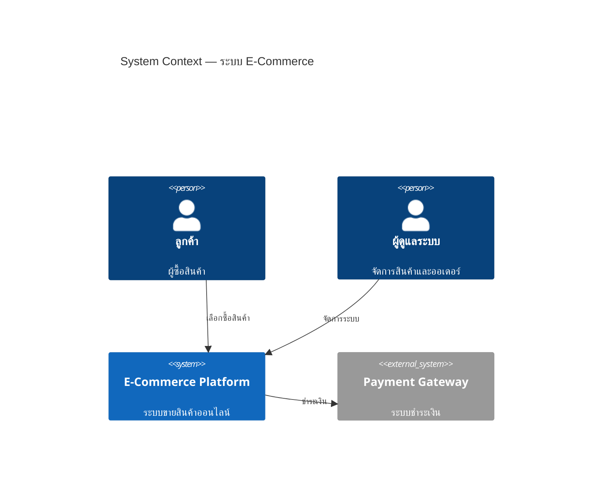

# เล่ม 4: แพ็กเกจ โมดูล สถาปัตยกรรม และเครื่องมือ
## คู่มือการทำงานฉบับสมบูรณ์ พร้อมตัวอย่างการใช้งานจริง

---

## บทนำเล่ม

หนังสือเล่มนี้เป็นคู่มือภาคปฏิบัติสำหรับนักพัฒนา Python ที่ต้องการยกระดับจาก "เขียนโค้ดให้ทำงานได้" สู่ "เขียนระบบที่ดูแลรักษาได้ ขยายได้ และส่งมอบได้อย่างมืออาชีพ" เนื้อหาครอบคลุมสี่เสาหลักที่นักพัฒนาระบบจริงต้องเชี่ยวชาญ ได้แก่

1. **การจัดการแพ็กเกจและโมดูล** — โครงสร้างโปรเจกต์ การนำเข้า การเผยแพร่สู่ PyPI
2. **สถาปัตยกรรมซอฟต์แวร์** — SDLC, UML, Layered Architecture, Clean Architecture, DDD, Microservices
3. **เครื่องมือและ Workflow** — Poetry, Ruff, pre-commit, CI/CD, Docker, Kubernetes
4. **สถาปัตยกรรมและ Design เพิ่มเติม** — C4 Model, ADR, 12-Factor App, Distributed Patterns, SRE

ทุกหัวข้อจะมาพร้อม **ตัวอย่างโค้ดที่รันได้จริง**, **คำสั่ง CLI ที่ใช้บ่อย**, และ **แนวปฏิบัติที่ดีที่สุดจากอุตสาหกรรม** พร้อมลิงก์อ้างอิงสำหรับศึกษาต่อยอด


## ภาค 10: การจัดการแพ็กเกจ โมดูล และการเผยแพร่

### 10.1 Module System

**คืออะไร:** ระบบโมดูลของ Python ช่วยให้แยกโค้ดออกเป็นไฟล์ `.py` แต่ละไฟล์เรียกว่า "โมดูล" ซึ่งสามารถนำเข้าไปใช้ในไฟล์อื่นได้ ระบบนี้เป็นรากฐานของการจัดระเบียบโค้ดใน Python

**ทำงานอย่างไร:** เมื่อ Python รัน `import mymodule` ระบบจะค้นหาไฟล์ `mymodule.py` ในตำแหน่งที่กำหนดโดย `sys.path` ซึ่งประกอบด้วย (1) ไดเรกทอรีปัจจุบัน (2) ไดเรกทอรีของสคริปต์ (3) ไดเรกทอรี `site-packages` (4) ตำแหน่งจากตัวแปรสภาพแวดล้อม `PYTHONPATH`

**ตัวอย่างการใช้งาน:**

```python
# math_utils.py
"""โมดูลสำหรับคำนวณทางคณิตศาสตร์"""

PI = 3.14159

def circle_area(radius: float) -> float:
    """คำนวณพื้นที่วงกลม"""
    return PI * radius ** 2

def rectangle_area(width: float, height: float) -> float:
    """คำนวณพื้นที่สี่เหลี่ยม"""
    return width * height
```

```python
# main.py
import math_utils

area = math_utils.circle_area(5.0)
print(f"พื้นที่วงกลมรัศมี 5 = {area:.2f}")

# หรือนำเข้าฟังก์ชันเฉพาะ
from math_utils import rectangle_area
print(f"พื้นที่สี่เหลี่ยม 3x4 = {rectangle_area(3, 4)}")
```

**ข้อควรระวัง:** การใช้ `sys.path.append()` เพื่อแก้ปัญหา import เป็นวิธีที่เปราะบาง ควรจัดโครงสร้างโปรเจกต์ให้ถูกต้องแทน


### 10.2 Package

**คืออะไร:** แพ็กเกจคือไดเรกทอรีที่ประกอบด้วยโมดูลหลายไฟล์ และมีไฟล์ `__init__.py` ทำหน้าที่เป็นจุดเริ่มต้นของแพ็กเกจ

**ตัวอย่างโครงสร้าง:**

```
my_package/
├── __init__.py          # ทำให้ไดเรกทอรีนี้เป็นแพ็กเกจ
├── models/
│   ├── __init__.py
│   ├── user.py
│   └── order.py
├── services/
│   ├── __init__.py
│   ├── auth.py
│   └── payment.py
└── utils/
    ├── __init__.py
    └── validators.py
```

**การใช้งาน:**

```python
# นำเข้าแพ็กเกจย่อย
from my_package.models import user
from my_package.services.auth import authenticate

# หรือนำเข้าผ่าน __init__.py
from my_package import models
```

**ข้อควรระวัง:** ตั้งแต่ Python 3.3 เป็นต้นมา PEP 420 รองรับ **Namespace Package** ซึ่งไม่จำเป็นต้องมี `__init__.py` แต่สำหรับแพ็กเกจทั่วไปที่ต้องเผยแพร่บน PyPI ยังคงแนะนำให้มี `__init__.py` เพื่อความเข้ากันได้และความชัดเจน


### 10.3 `__init__.py`

**คืออะไร:** ไฟล์พิเศษที่ทำหน้าที่สองอย่าง: (1) ทำให้ไดเรกทอรีนั้นถูกมองว่าเป็นแพ็กเกจ Python (2) รันโค้ด initialization เมื่อแพ็กเกจถูก import

**แนวปฏิบัติที่ดี:**

```python
# my_package/__init__.py
"""My Package - เครื่องมือจัดการข้อมูล"""

__version__ = "1.0.0"
__author__ = "Kongnakorn Jantakun"

# ควบคุมสิ่งที่ถูก export เมื่อใช้ `from my_package import *`
__all__ = ["DataProcessor", "load_config"]

# นำเข้าคลาสหลักเพื่อให้ผู้ใช้เข้าถึงได้ง่าย
from .core import DataProcessor
from .config import load_config
```

**ข้อควรระวัง:** อย่าใส่โค้ดที่มีผลข้างเคียง (side effects) มากเกินไปใน `__init__.py` เพราะจะทำให้ import ช้าและเกิด circular import ได้ง่าย


### 10.5 Import System

**คืออะไร:** กลไกที่ Python ใช้ค้นหา โหลด และผูกโมดูลเข้าด้วยกัน ประกอบด้วย Finder (ค้นหา), Loader (โหลด), และ Meta Path

**หลักการสำคัญ:**

| ประเภท | ตัวอย่าง | ใช้เมื่อ |
|--------|---------|---------|
| Absolute Import | `from mypackage.models import User` | แนะนำเสมอ |
| Relative Import | `from .models import User` | ภายในแพ็กเกจเดียวกัน |
| Relative Import (parent) | `from ..utils import helper` | ข้ามระดับแพ็กเกจ |

**ตัวอย่าง Circular Import และวิธีแก้:**

```python
# ❌ ปัญหา: a.py นำเข้า b.py และ b.py นำเข้า a.py
# a.py
from b import process_b
def process_a(): return process_b()

# b.py
from a import process_a  # Circular!
def process_b(): return process_a()
```

**วิธีแก้ที่ 1 — ย้าย import เข้าไปในฟังก์ชัน:**

```python
# b.py
def process_b():
    from a import process_a  # import ตอนใช้
    return process_a()
```

**วิธีแก้ที่ 2 — ใช้ `import module` แทน `from module import name`:**

```python
# b.py
import a  # import ทั้งโมดูล ไม่ดึงชื่อออกมา
def process_b():
    return a.process_a()
```

**ข้อควรระวัง:** Circular import มักเกิดจาก `from module import name` ที่ระดับบนสุดของไฟล์ วิธีที่ปลอดภัยที่สุดคือการจัดโครงสร้าง dependency ให้เป็นทิศทางเดียว (DAG)


### 10.9 setuptools

**คืออะไร:** เครื่องมือมาตรฐานสำหรับสร้างและเผยแพร่แพ็กเกจ Python ใช้ร่วมกับ `pyproject.toml`

**ตัวอย่าง `pyproject.toml` แบบสมบูรณ์:**

```toml
[build-system]
requires = ["setuptools >= 77.0.3", "wheel"]
build-backend = "setuptools.build_meta"

[project]
name = "my-awesome-package"
version = "1.0.0"
description = "แพ็กเกจตัวอย่างสำหรับคู่มือ"
readme = "README.md"
license = { text = "MIT" }
authors = [
    { name = "Kongnakorn Jantakun", email = "kongnakornjantakun@gmail.com" }
]
requires-python = ">=3.10"
classifiers = [
    "Development Status :: 4 - Beta",
    "Intended Audience :: Developers",
    "Programming Language :: Python :: 3.10",
    "Programming Language :: Python :: 3.11",
    "Programming Language :: Python :: 3.12",
]
dependencies = [
    "requests>=2.31.0",
    "pydantic>=2.0",
]

[project.optional-dependencies]
dev = ["pytest>=8.0", "ruff>=0.4.0", "mypy>=1.10"]
docs = ["mkdocs>=1.6", "mkdocs-material>=9.0"]

[project.scripts]
my-cli = "my_awesome_package.cli:main"

[project.urls]
Homepage = "https://github.com/kongnakorn/my-awesome-package"
Repository = "https://github.com/kongnakorn/my-awesome-package.git"
Documentation = "https://kongnakorn.github.io/my-awesome-package"
```

**คำสั่งที่ใช้บ่อย:**

```bash
# สร้าง source distribution และ wheel
python -m build

# ติดตั้งแบบ editable (สำหรับพัฒนา)
pip install -e .

# ติดตั้งพร้อม dev dependencies
pip install -e ".[dev]"
```

**อ้างอิง:** [packaging.python.org](https://packaging.python.org/en/latest/guides/writing-pyproject-toml/)


### 10.13 PyPI

**คืออะไร:** Python Package Index — คลังแพ็กเกจสาธารณะที่ใหญ่ที่สุดสำหรับ Python

**ขั้นตอนการเผยแพร่:**

```bash
# 1. ติดตั้ง twine
pip install twine

# 2. สร้าง distribution files
python -m build

# 3. ตรวจสอบไฟล์
twine check dist/*

# 4. อัปโหลดไปยัง TestPyPI ก่อน (สำหรับทดสอบ)
twine upload --repository testpypi dist/*

# 5. ทดสอบติดตั้งจาก TestPyPI
pip install --index-url https://test.pypi.org/simple/ my-awesome-package

# 6. อัปโหลดไปยัง PyPI จริง
twine upload dist/*
```

**ข้อควรระวัง:** ต้องสร้าง API Token จาก PyPI และเก็บไว้ใน `~/.pypirc` หรือใช้ environment variables `TWINE_USERNAME` และ `TWINE_PASSWORD` อย่า commit token ลงใน git


### 10.17 Versioning & Semantic Versioning

**คืออะไร:** Semantic Versioning (SemVer) คือมาตรฐานการกำหนดเลขเวอร์ชันในรูปแบบ `MAJOR.MINOR.PATCH`

| ส่วน | ความหมาย | เปลี่ยนเมื่อ |
|------|----------|-------------|
| MAJOR | Breaking changes | API ไม่เข้ากันกับเวอร์ชันก่อน |
| MINOR | New features | เพิ่มฟีเจอร์ใหม่แบบ backward-compatible |
| PATCH | Bug fixes | แก้บั๊กแบบ backward-compatible |

**การใช้งานกับ Python Semantic Release:**

```bash
pip install python-semantic-release
```

```toml
# pyproject.toml
[tool.semantic_release]
version_variables = ["src/my_package/__init__.py:__version__"]
branch = "main"
commit_parser = "conventional"
```

**Conventional Commits ที่ใช้:**

```
feat: เพิ่มฟีเจอร์ใหม่          → MINOR bump
fix: แก้บั๊ก                   → PATCH bump
feat!: เปลี่ยน API แบบ breaking  → MAJOR bump
docs: แก้เอกสาร               → ไม่ bump
chore: งานทั่วไป               → ไม่ bump
```

**อ้างอิง:** [python-semantic-release.readthedocs.io](https://python-semantic-release.readthedocs.io/)


## ภาค 11: การออกแบบระบบและสถาปัตยกรรมซอฟต์แวร์

### 11.14 Clean Architecture

**คืออะไร:** สถาปัตยกรรมที่แบ่งระบบออกเป็น 4 ชั้น โดยมีกฎเหล็ก: **Dependencies ชี้เข้าข้างในเท่านั้น** ชั้นในไม่รู้จักชั้นนอก

**แผนภาพ 4 ชั้น:**

```
┌─────────────────────────────────────────────────┐
│ Layer 4: Frameworks & Drivers (FastAPI, DB)     │ ← นอกสุด
│  ┌───────────────────────────────────────────┐  │
│  │ Layer 3: Interface Adapters (Controllers) │  │
│  │  ┌─────────────────────────────────────┐  │  │
│  │  │ Layer 2: Use Cases (Application)    │  │  │
│  │  │  ┌───────────────────────────────┐  │  │  │
│  │  │  │ Layer 1: Entities (Business)  │  │  │  │ ← ในสุด
│  │  │  │ NO DEPENDENCIES!              │  │  │  │
│  │  │  └───────────────────────────────┘  │  │  │
│  │  └─────────────────────────────────────┘  │  │
│  └───────────────────────────────────────────┘  │
└─────────────────────────────────────────────────┘
```

**ตัวอย่างโค้ดจริง — ระบบธนาคาร:**

```python
# ===== Layer 1: Entities =====
# src/entities/account.py
from dataclasses import dataclass, field
from decimal import Decimal
from datetime import datetime
from uuid import UUID, uuid4

@dataclass
class Account:
    """Entity: บัญชีธนาคาร — Business Rules ล้วน ไม่พึ่งพาอะไร"""
    id: UUID = field(default_factory=uuid4)
    owner_name: str = ""
    balance: Decimal = Decimal("0.00")
    created_at: datetime = field(default_factory=datetime.utcnow)

    def deposit(self, amount: Decimal) -> None:
        if amount <= 0:
            raise ValueError("จำนวนเงินฝากต้องมากกว่าศูนย์")
        self.balance += amount

    def withdraw(self, amount: Decimal) -> None:
        if amount <= 0:
            raise ValueError("จำนวนเงินถอนต้องมากกว่าศูนย์")
        if amount > self.balance:
            raise ValueError("ยอดเงินไม่เพียงพอ")
        self.balance -= amount
```

```python
# ===== Layer 2: Use Cases =====
# src/use_cases/transfer_money.py
from abc import ABC, abstractmethod
from decimal import Decimal
from entities.account import Account

class AccountRepository(ABC):
    """Interface — Layer 2 กำหนด, Layer 4 implement"""
    @abstractmethod
    def find_by_id(self, account_id: str) -> Account | None: ...
    @abstractmethod
    def save(self, account: Account) -> None: ...

class TransferMoneyUseCase:
    """Use Case: โอนเงิน — ประสานงาน Entities"""
    def __init__(self, repo: AccountRepository):
        self.repo = repo

    def execute(self, from_id: str, to_id: str, amount: Decimal) -> None:
        from_acc = self.repo.find_by_id(from_id)
        to_acc = self.repo.find_by_id(to_id)

        if not from_acc or not to_acc:
            raise ValueError("ไม่พบบัญชี")

        from_acc.withdraw(amount)
        to_acc.deposit(amount)

        self.repo.save(from_acc)
        self.repo.save(to_acc)
```

```python
# ===== Layer 3: Interface Adapters =====
# src/adapters/api_controller.py
from fastapi import APIRouter, HTTPException
from decimal import Decimal
from use_cases.transfer_money import TransferMoneyUseCase
from infrastructure.sql_repository import SqlAccountRepository

router = APIRouter()

@router.post("/transfer")
def transfer(from_id: str, to_id: str, amount: float):
    repo = SqlAccountRepository()  # Layer 4
    use_case = TransferMoneyUseCase(repo)
    try:
        use_case.execute(from_id, to_id, Decimal(str(amount)))
        return {"status": "success"}
    except ValueError as e:
        raise HTTPException(status_code=400, detail=str(e))
```

**ข้อดี:** ทดสอบง่าย (mock repository), เปลี่ยน framework ได้โดยไม่กระทบ business logic, รองรับทีมขนาดใหญ่
**ข้อเสีย:** โค้ดเยอะขึ้น, มี abstraction หลายชั้น, เหมาะกับระบบใหญ่ (20+ dev, 10+ ปี)

**อ้างอิง:** [Clean Architecture Banking Example](https://github.com/phdsystems/software-engineering-labs)


### 11.22 Domain-Driven Design (DDD)

**คืออะไร:** แนวทางออกแบบซอฟต์แวร์ที่เน้นการสร้างโมเดลที่สะท้อน **โดเมนธุรกิจ** อย่างแม่นยำ โดยนักพัฒนาและผู้เชี่ยวชาญด้านธุรกิจทำงานร่วมกัน

**Tactical Patterns หลัก:**

```python
# Value Object — ไม่มี identity, immutable
from dataclasses import dataclass
from decimal import Decimal

@dataclass(frozen=True)
class Money:
    amount: Decimal
    currency: str = "THB"

    def add(self, other: "Money") -> "Money":
        if self.currency != other.currency:
            raise ValueError("สกุลเงินไม่ตรงกัน")
        return Money(self.amount + other.amount, self.currency)

# Entity — มี identity
@dataclass
class Order:
    order_id: str
    items: list["OrderItem"]
    status: str = "pending"

    def total(self) -> Money:
        total = Money(Decimal("0"))
        for item in self.items:
            total = total.add(item.subtotal())
        return total

# Aggregate — cluster ของ entities ที่จัดการผ่าน root
# Order เป็น Aggregate Root ของ OrderItem
```

**Bounded Context:**

```
┌─────────────────┐  ┌─────────────────┐
│  Sales Context   │  │ Billing Context  │
│  (Customer =    │  │  (Customer =     │
│   Lead/Prospect)│  │   Payer)         │
└─────────────────┘  └─────────────────┘
        │                     │
        └──── Shared Kernel ──┘
              (Customer ID)
```

**ข้อควรระวัง:** DDD เหมาะกับโดเมนธุรกิจที่ซับซ้อน ไม่ควรนำมาใช้กับ CRUD ทั่วไป เพราะจะเพิ่มความซับซ้อนโดยไม่จำเป็น

**อ้างอิง:** [python-ddd-example (GitHub)](https://github.com/otsobide/python-ddd-example)


### 11.35 Design Patterns

**คืออะไร:** แนวทางแก้ปัญหาที่ผ่านการพิสูจน์แล้วสำหรับปัญหาที่พบบ่อยในการออกแบบซอฟต์แวร์ แบ่งเป็น 3 หมวด:

#### Creational Patterns (การสร้างวัตถุ)

**Singleton — Module-level:**

```python
# config.py — Pythonic Singleton
"""โมดูลถูก import เพียงครั้งเดียวและแคชไว้"""
import os
from typing import Any

class _Config:
    def __init__(self):
        self._settings: dict[str, Any] = {}
        self._loaded = False

    def load(self) -> None:
        if not self._loaded:
            self._settings = {
                "db_url": os.environ.get("DATABASE_URL", "sqlite:///app.db"),
                "debug": os.environ.get("DEBUG", "0") == "1",
            }
            self._loaded = True

    def get(self, key: str, default: Any = None) -> Any:
        self.load()
        return self._settings.get(key, default)

config = _Config()  # instance เดียวตลอดอายุโปรแกรม
```

**Factory Method:**

```python
from abc import ABC, abstractmethod

class Notification(ABC):
    @abstractmethod
    def send(self, message: str) -> None: ...

class EmailNotification(Notification):
    def send(self, message: str) -> None:
        print(f"📧 ส่งอีเมล: {message}")

class SMSNotification(Notification):
    def send(self, message: str) -> None:
        print(f"📱 ส่ง SMS: {message}")

class NotificationFactory:
    @staticmethod
    def create(channel: str) -> Notification:
        match channel:
            case "email": return EmailNotification()
            case "sms": return SMSNotification()
            case _: raise ValueError(f"ไม่รู้จักช่องทาง: {channel}")

# ใช้งาน
notifier = NotificationFactory.create("email")
notifier.send("สวัสดี!")
```

#### Structural Patterns (การประกอบวัตถุ)

**Decorator (Pythonic):**

```python
import functools
import time

def timing(func):
    """Decorator วัดเวลาทำงาน"""
    @functools.wraps(func)
    def wrapper(*args, **kwargs):
        start = time.perf_counter()
        result = func(*args, **kwargs)
        elapsed = time.perf_counter() - start
        print(f"⏱️ {func.__name__} ใช้เวลา {elapsed:.4f} วินาที")
        return result
    return wrapper

@timing
def process_data(n: int) -> int:
    return sum(range(n))

process_data(1_000_000)
```

#### Behavioral Patterns (การสื่อสารระหว่างวัตถุ)

**Strategy:**

```python
from abc import ABC, abstractmethod

class PaymentStrategy(ABC):
    @abstractmethod
    def pay(self, amount: float) -> None: ...

class CreditCardPayment(PaymentStrategy):
    def pay(self, amount: float) -> None:
        print(f"💳 ชำระ ฿{amount} ด้วยบัตรเครดิต")

class PromptPayPayment(PaymentStrategy):
    def pay(self, amount: float) -> None:
        print(f"📲 ชำระ ฿{amount} ด้วย PromptPay")

class PaymentProcessor:
    def __init__(self, strategy: PaymentStrategy):
        self._strategy = strategy

    def process(self, amount: float) -> None:
        self._strategy.pay(amount)

# เปลี่ยน strategy ได้ตามต้องการ
processor = PaymentProcessor(PromptPayPayment())
processor.process(1500.00)
```

**อ้างอิง:** [Python Design Patterns Guide](https://raw.githubusercontent.com/OneUptime/blog/refs/heads/master/posts/2025-07-02-python-design-patterns/README.md)


## ภาค 29: เครื่องมือและ Workflow เพิ่มเติม

### 29.1 Poetry

**คืออะไร:** เครื่องมือจัดการ dependencies และแพ็กเกจที่ทันสมัย จัดการทั้ง virtual environment, dependency resolution, build และ publish

**การติดตั้งและเริ่มต้น:**

```bash
# ติดตั้ง Poetry
curl -sSL https://install.python-poetry.org | python3 -

# สร้างโปรเจกต์ใหม่
poetry new my-project --name my_package

# หรือเริ่มในโปรเจกต์ที่มีอยู่แล้ว
cd existing-project
poetry init
```

**คำสั่งที่ใช้บ่อย:**

```bash
# เพิ่ม dependency
poetry add requests pydantic

# เพิ่ม dev dependency
poetry add --group dev pytest ruff mypy

# ติดตั้ง dependencies ทั้งหมด
poetry install

# อัปเดต dependencies
poetry update

# รันคำสั่งใน virtual environment
poetry run python -m pytest

# เข้า shell
poetry shell

# build แพ็กเกจ
poetry build

# publish ไปยัง PyPI
poetry publish
```

**โครงสร้าง `pyproject.toml` ของ Poetry:**

```toml
[tool.poetry]
name = "my-project"
version = "1.0.0"
description = ""
authors = ["Kongnakorn Jantakun <kongnakornjantakun@gmail.com>"]

[tool.poetry.dependencies]
python = "^3.10"
requests = "^2.31"
pydantic = "^2.0"

[tool.poetry.group.dev.dependencies]
pytest = "^8.0"
ruff = "^0.4"
```

**อ้างอิง:** [Poetry Documentation](https://python-poetry.org)


### 29.8 Ruff

**คืออะไร:** Linter และ Formatter ที่เขียนด้วย Rust ความเร็วสูง แทนที่ Flake8, isort, Black, pyupgrade และอีกหลายเครื่องมือในตัวเดียว

**การติดตั้งและตั้งค่า:**

```bash
pip install ruff
```

```toml
# pyproject.toml
[tool.ruff]
line-length = 100
target-version = "py310"

[tool.ruff.lint]
select = [
    "E",   # pycodestyle errors
    "W",   # pycodestyle warnings
    "F",   # Pyflakes
    "I",   # isort
    "B",   # flake8-bugbear
    "C4",  # flake8-comprehensions
    "UP",  # pyupgrade
    "SIM", # flake8-simplify
]
ignore = ["E501"]  # line too long (จัดการโดย formatter)

[tool.ruff.lint.per-file-ignores]
"tests/**/*.py" = ["S101"]  # อนุญาต assert ในเทส
```

**คำสั่งที่ใช้:**

```bash
# ตรวจสอบโค้ด
ruff check .

# ตรวจสอบและแก้ไขอัตโนมัติ
ruff check --fix .

# Format โค้ด
ruff format .

# ตรวจสอบ format (โดยไม่แก้ไข)
ruff format --check .
```

**อ้างอิง:** [Ruff Documentation](https://docs.astral.sh/ruff/)


### 29.17 pre-commit

**คืออะไร:** Framework สำหรับจัดการ Git hooks รันเครื่องมือคุณภาพโค้ดก่อนที่ developer จะ commit โค้ด

**การติดตั้งและตั้งค่า:**

```bash
pip install pre-commit
pre-commit install  # ติดตั้ง hook ใน .git/hooks/
```

```yaml
# .pre-commit-config.yaml
repos:
  - repo: https://github.com/pre-commit/pre-commit-hooks
    rev: v4.6.0
    hooks:
      - id: trailing-whitespace
      - id: end-of-file-fixer
      - id: check-yaml
      - id: check-added-large-files
      - id: detect-private-key

  - repo: https://github.com/astral-sh/ruff-pre-commit
    rev: v0.4.4
    hooks:
      - id: ruff
        args: [--fix]
      - id: ruff-format

  - repo: https://github.com/pre-commit/mirrors-mypy
    rev: v1.10.0
    hooks:
      - id: mypy
        additional_dependencies: [pydantic>=2.0]
```

**คำสั่งที่ใช้:**

```bash
# รัน hooks กับไฟล์ที่ staged
pre-commit run

# รันกับทุกไฟล์
pre-commit run --all-files

# อัปเดต hook versions
pre-commit autoupdate
```

**อ้างอิง:** [pre-commit Documentation](https://pre-commit.com)


### 29.42 GitHub Actions

**คืออะไร:** ระบบ CI/CD ที่มาพร้อมกับ GitHub ใช้สำหรับ automate การทดสอบ build และ deploy

**ตัวอย่าง Workflow สำหรับ Python:**

```yaml
# .github/workflows/ci.yml
name: CI

on:
  push:
    branches: [main, develop]
  pull_request:
    branches: [main]

jobs:
  test:
    runs-on: ubuntu-latest
    strategy:
      matrix:
        python-version: ["3.10", "3.11", "3.12"]

    steps:
      - uses: actions/checkout@v4

      - name: Set up Python ${{ matrix.python-version }}
        uses: actions/setup-python@v5
        with:
          python-version: ${{ matrix.python-version }}

      - name: Install Poetry
        uses: snok/install-poetry@v1
        with:
          version: 1.8.3

      - name: Install dependencies
        run: poetry install --no-interaction

      - name: Lint with Ruff
        run: poetry run ruff check .

      - name: Type check with mypy
        run: poetry run mypy src/

      - name: Test with pytest
        run: poetry run pytest --cov=src --cov-fail-under=80

  build:
    needs: test
    runs-on: ubuntu-latest
    steps:
      - uses: actions/checkout@v4
      - name: Build package
        run: |
          pip install build
          python -m build
      - name: Upload artifacts
        uses: actions/upload-artifact@v4
        with:
          name: dist
          path: dist/
```

**อ้างอิง:** [GitHub Actions Documentation](https://docs.github.com/en/actions)


### 29.39 Dockerfile

**คืออะไร:** ไฟล์ข้อความที่กำหนดวิธีสร้าง Docker image สำหรับแอปพลิเคชัน Python

**Dockerfile ที่ดีที่สุดสำหรับ Python:**

```dockerfile
# ใช้ specific version + slim base
FROM python:3.12.3-slim AS builder

# ตั้งค่า environment
ENV PYTHONDONTWRITEBYTECODE=1 \
    PYTHONUNBUFFERED=1 \
    PIP_NO_CACHE_DIR=1

WORKDIR /app

# ติดตั้ง build dependencies
RUN apt-get update && apt-get install -y --no-install-recommends \
    build-essential \
    && rm -rf /var/lib/apt/lists/*

# คัดลอกเฉพาะ dependency files ก่อน (เพื่อ cache)
COPY pyproject.toml poetry.lock ./
RUN pip install poetry && \
    poetry config virtualenvs.create false && \
    poetry install --no-dev --no-interaction --no-ansi

# คัดลอก source code
COPY src/ ./src/

# ---- Runtime stage ----
FROM python:3.12.3-slim

RUN groupadd --gid 1001 appuser && \
    useradd --uid 1001 --gid 1001 --create-home appuser

WORKDIR /app
COPY --from=builder /usr/local/lib/python3.12/site-packages /usr/local/lib/python3.12/site-packages
COPY --from=builder /usr/local/bin /usr/local/bin
COPY --from=builder /app/src ./src

USER appuser

EXPOSE 8000
CMD ["python", "-m", "uvicorn", "src.main:app", "--host", "0.0.0.0", "--port", "8000"]
```

```dockerignore
# .dockerignore
__pycache__/
*.py[cod]
*.egg-info/
.venv/
.git/
.env
.pytest_cache/
.mypy_cache/
.ruff_cache/
dist/
build/
```

**แนวปฏิบัติที่ดี:**
- ใช้ `python:3.12.3-slim` ไม่ใช่ `python:3.12` (pin version)
- ใช้ multi-stage build เพื่อลดขนาด image
- รันด้วย non-root user
- ใช้ `.dockerignore` เพื่อลด build context

**อ้างอิง:** [Docker Python Guide](https://docs.docker.com/language/python/)


## ภาค 30: สถาปัตยกรรมและ Design เพิ่มเติม

### 30.1 C4 Model

**คืออะไร:** Framework สำหรับสร้างแผนภาพสถาปัตยกรรมซอฟต์แวร์ 4 ระดับ: Context → Container → Component → Code

**ระดับของ C4:**

| ระดับ | ชื่อ | คำอธิบาย | ผู้ชม |
|-------|------|----------|-------|
| 1 | Context | ระบบและผู้ใช้ภายนอก | ทุกคน |
| 2 | Container | แอป, บริการ, ฐานข้อมูล | Technical |
| 3 | Component | โมดูลภายใน container | Developer |
| 4 | Code | คลาส, interface | Developer (ไม่บังคับ) |

**ตัวอย่าง Mermaid สำหรับ C4 Context:**



**อ้างอิง:** [C4 Model Guide](https://icepanel.io/blog/how-to-create-common-architecture-diagrams-with-the-c4-model)


### 30.3 ADR (Architecture Decision Record)

**คืออะไร:** เอกสารสั้นที่บันทึกการตัดสินใจทางสถาปัตยกรรมที่สำคัญ พร้อมบริบทและเหตุผล

**Template ADR:**

```markdown
# ADR-001: เลือกใช้ FastAPI สำหรับ REST API

## สถานะ
Accepted

## วันที่
2026-09-17

## บริบท
ทีมต้องการสร้าง REST API สำหรับระบบใหม่ ต้องรองรับ async, 
มี auto-documentation และมี performance สูง

## การตัดสินใจ
เลือกใช้ FastAPI เป็น web framework หลัก

## เหตุผล
- รองรับ async/await native
- Auto-generate OpenAPI/Swagger docs
- Pydantic validation ในตัว
- Performance ใกล้เคียง Go/Node.js
- Community ใหญ่และเติบโตเร็ว

## ทางเลือกที่พิจารณา
- Flask: ไม่รองรับ async native, ต้องใช้ extension
- Django REST: หนักเกินไปสำหรับ API-only service
- Sanic: community เล็กกว่า, docs น้อยกว่า

## ผลกระทบ
- ✅ พัฒนาเร็ว, docs อัตโนมัติ
- ⚠️ ต้องเรียนรู้ Pydantic และ async patterns
- ⚠️ Ecosystem อาจไม่ mature เท่า Django
```


### 30.6 12-Factor App

**คืออะไร:** หลักการ 12 ข้อสำหรับสร้าง SaaS application ที่ scalable และ portable

**12 Factors และการประยุกต์กับ Python:**

| # | Factor | วิธีปฏิบัติใน Python |
|---|--------|---------------------|
| 1 | Codebase | Git repo เดียว, deploy หลาย environment |
| 2 | Dependencies | `pyproject.toml` + `poetry.lock` |
| 3 | Config | `os.environ` ไม่ใช่ `settings.py` ที่ commit |
| 4 | Backing Services | ใช้ URL จาก env var (DB, Redis, etc.) |
| 5 | Build/Release/Run | CI สร้าง wheel, deploy, รัน |
| 6 | Processes | Stateless — เก็บ session ใน Redis |
| 7 | Port Binding | `uvicorn --host 0.0.0.0 --port $PORT` |
| 8 | Concurrency | Scale ด้วย process (gunicorn workers) |
| 9 | Disposability | Fast startup, graceful shutdown |
| 10 | Dev/Prod Parity | Docker compose สำหรับ local |
| 11 | Logs | `logging` → stdout ไม่เขียนไฟล์ |
| 12 | Admin Processes | `python -m flask db upgrade` |

**ตัวอย่าง Config ที่ถูกต้อง:**

```python
# config.py — อ่านจาก environment
import os
from dataclasses import dataclass

@dataclass
class Config:
    database_url: str = os.environ.get("DATABASE_URL", "sqlite:///dev.db")
    redis_url: str = os.environ.get("REDIS_URL", "redis://localhost:6379")
    secret_key: str = os.environ.get("SECRET_KEY", "dev-only-secret")
    debug: bool = os.environ.get("DEBUG", "0") == "1"
    log_level: str = os.environ.get("LOG_LEVEL", "INFO")

config = Config()
```

**อ้างอิง:** [12-Factor App (Real Python)](https://realpython.com/ref/software-engineering-glossary/twelve-factor-app/)


### 30.73 SRE (Site Reliability Engineering)

**คืออะไร:** แนวปฏิบัติในการดูแลระบบให้มีความน่าเชื่อถือสูง โดยใช้หลักการทางวิศวกรรมซอฟต์แวร์

**แนวคิดหลัก:**

| แนวคิด | ความหมาย | ตัวอย่าง |
|--------|----------|---------|
| SLI | Service Level Indicator — ตัวชี้วัด | % availability, latency p99 |
| SLO | Service Level Objective — เป้าหมาย | 99.9% uptime |
| SLA | Service Level Agreement — สัญญา | คืนเงินถ้า uptime < 99.5% |
| Error Budget | งบข้อผิดพลาด = 100% - SLO | 0.1% = 43 นาที/เดือน |

**ตัวอย่าง SLO ที่ดี:**

```yaml
# slo.yaml
service: payment-api
slos:
  - name: availability
    description: "เปอร์เซ็นต์ของ request ที่สำเร็จ"
    sli:
      type: request_based
      good: "http_response_code < 500"
      total: "all_requests"
    objective: 99.9
    window: 30d

  - name: latency
    description: "p99 latency ต่ำกว่า 500ms"
    sli:
      type: request_based
      good: "latency < 500ms"
      total: "all_requests"
    objective: 99.0
    window: 30d
```

**แนวปฏิบัติ:**
- ตั้ง SLO ที่ท้าทายแต่ achievable (99.9% ดีกว่า 100%)
- ใช้ Error Budget เป็นตัวตัดสินใจว่า deploy ได้หรือไม่
- ทำ Postmortem แบบ blameless เมื่อเกิด incident
- Automate Toil (งานซ้ำซาก) ด้วย script


## สรุป

หนังสือเล่ม 4 นี้ครอบคลุมสี่เสาหลักที่สำคัญสำหรับนักพัฒนา Python มืออาชีพ:

1. **การจัดการแพ็กเกจและโมดูล** — ตั้งแต่ `pyproject.toml` การจัดการ import ไปจนถึงการเผยแพร่บน PyPI ด้วย Semantic Versioning

2. **สถาปัตยกรรมซอฟต์แวร์** — Clean Architecture, DDD, Design Patterns พร้อมตัวอย่างโค้ดที่รันได้จริง

3. **เครื่องมือและ Workflow** — Poetry, Ruff, pre-commit, GitHub Actions, Docker ที่ช่วยให้การพัฒนามืออาชีพเป็นไปอย่างราบรื่น

4. **สถาปัตยกรรมและ Design เพิ่มเติม** — C4 Model สำหรับ visualize, ADR สำหรับบันทึกการตัดสินใจ, 12-Factor App สำหรับ cloud-native, SRE สำหรับดูแลระบบ

**หลักการสำคัญที่ควรจดจำ:**
- จัดโครงสร้างโปรเจกต์ให้ดีตั้งแต่วันแรก — การ refactor ทีหลังจะแพงกว่า
- ใช้ tooling อัตโนมัติ (Ruff, pre-commit, CI) เพื่อบังคับคุณภาพโค้ด
- เลือกสถาปัตยกรรมให้เหมาะกับขนาดทีมและอายุระบบ — อย่า over-engineer
- เขียน ADR ทุกครั้งที่มีการตัดสินใจสำคัญ

**แหล่งอ้างอิงหลัก:**
- [Python Packaging User Guide](https://packaging.python.org)
- [Clean Architecture in Python (GitHub)](https://github.com/phdsystems/software-engineering-labs)
- [Ruff Documentation](https://docs.astral.sh/ruff/)
- [Poetry Documentation](https://python-poetry.org)
- [12-Factor App](https://12factor.net)
- [C4 Model](https://c4model.com)